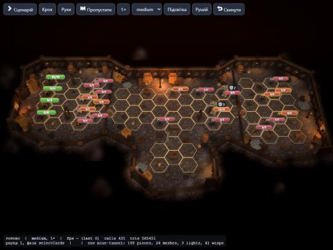
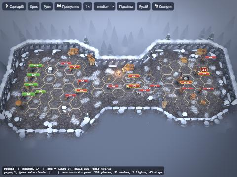
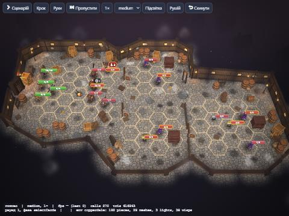
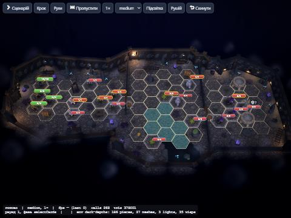
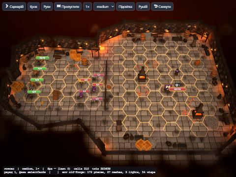

# Акт II «Сиві гори»: оточення s6–s10

Перевірка: `/vidvazhni/dev/board.html?board=s6…s10&quality=low|medium|high` (дев-сторінка сама додає мапи й монстрів Акту II, поки їх немає в `loadContent()`).

П'ять локацій у `data/environments/`, за правилами [showcase-s1.md](showcase-s1.md) і [atmosphere.md](atmosphere.md): одна суцільна підлога з рельєфом, гекси — лише сітка, прямі стіни поза ігровими гексами, групи пропів із контактними тінями, свій грейд і світло на кожну локацію.

| Сценарій | Локація | Край | Світло й грейд | Погода | Обжитість |
|---|---|---|---|---|---|
| s6 | `mine-tunnel` | `mine`: скеля за дерев'яним кріпленням, мідні жили, ліхтарі на стінах | темно, тепло-буро, світло лише плямами від ліхтарів | пил | вагонетки на рейках, руда, стоси кріпильного лісу, щебінь; на стінах додаткові стійки |
| s7 | `mountain-pass` | `cliff`: прямі скелі зі снігом, іній на стінах | холодне блякле денне світло, синюватий туман | сніг із вітром | сніг на підлозі, валуни в снігу, тури, ялини в снігу, далекі скелі |
| s8 | `copperdale` | `timber`: фасади хат | сутінки, теплий факел і вогнище розбійників | легкий сніг | бочки, ящики, вагонетки з рудою, стійка зброї, дзвін, далекі хати |
| s9 | `dark-depths` | `mine`, брама — `forge` | дуже темно й холодно, вода, слабкий фіолет Мороку | спори в повітрі | вода, сталагміти, гриби, кристали, руда |
| s10 | `old-forge` | `forge`: цегла з залізом, жар у стінах | гаряче помаранчеве світло на чорній кіптяві | іскри догори | вугілля, ковадла, корита, ланцюги на стінах і рамах |

| | |
|---|---|
|  |  |
|  |  |
|  | |

## Що додано в код

- Стилі краю `mine`, `cliff`, `forge` (`plan.ts`, схема) і їхні процедурні стіни, кути й проходи (`pieces.ts`).
- Нові деталі: `mine-support`, `mine-lantern`, `mine-lamp`, `ore-pile`, `timber-stack`, `snow-rock`, `snow-pine`, `cairn`, `pennant-pole`, `campfire`, `bell-post`, `house-far`, `forge`, `dark-lantern`, `anvil`, `chain-hoist`, `quench-trough`, `coal-pile`; матеріали `ore`, `snow`, `ember` (жар мерехтить разом із вогнем).
- Об'єкти сценаріїв: вагонетка Фліпа (`mine-cart:stuck|free`), перешкода `rubble` — купа каміння.
- Декалі: сніг на підлозі, мідна жила й іній на стінах; варіанти стін `support` (стійка в шахті) і `chains` (ланцюги в кузні). Грейд кожної локації — `ATMOSPHERE` в `atmosphere.ts`.
- Погода `weather` (`ambient.ts`): сніг, пил або іскри по всій локації, один виклик малювання; частка 30 / 60 / 100 % на low / medium / high.

## Моделі, яких бракує

Промпти ChatGPT (суворі, два проходи) у `art/prompts/props/`, записи в `art/prompts/manifest.json` (черга 67–76). Поки моделей немає, стоять процедурні заглушки; модель підхопиться сама через `propModels`.

| Модель | Де | Висота |
|---|---|---|
| `mine-cart` | s6 (Фліп), s8, s9 | 0,75 |
| `mine-support` | s6, s9 (перешкода) | 1,45 |
| `campfire` | s7, s8 | 0,5 |
| `pennant-pole` | s7 (об'єкт) | 2,1 |
| `forge` | s10 (об'єкт) | 1,9 |
| `dark-lantern` | s10 (об'єкт) | 1,15 |
| `anvil` | s10 | 0,6 |
| `ore-pile` | s6, s8, s9, s10 | 0,45 |
| `mine-lantern` | s6, s9 | 1,5 |
| `chain-hoist` | s10 | 1,8 |

З наявних Meshy-моделей використано: `barrel`, `crate`, `crate-stack`, `crate-broken`, `sacks-pile`, `flour-sack`, `rubble-pile`, `brazier`, `chest`, `dungeon-door`, `bear-trap`, `prisoner-cage`.

**Далі:** Blender-кіт стін (`env-mine`, `env-forge`, `env-pass`) за контрактом із `src/render/environment/README.md`; окрема текстура підлоги для шахти й снігу (зараз `cave-rock` і `cobblestone` з тонуванням).
