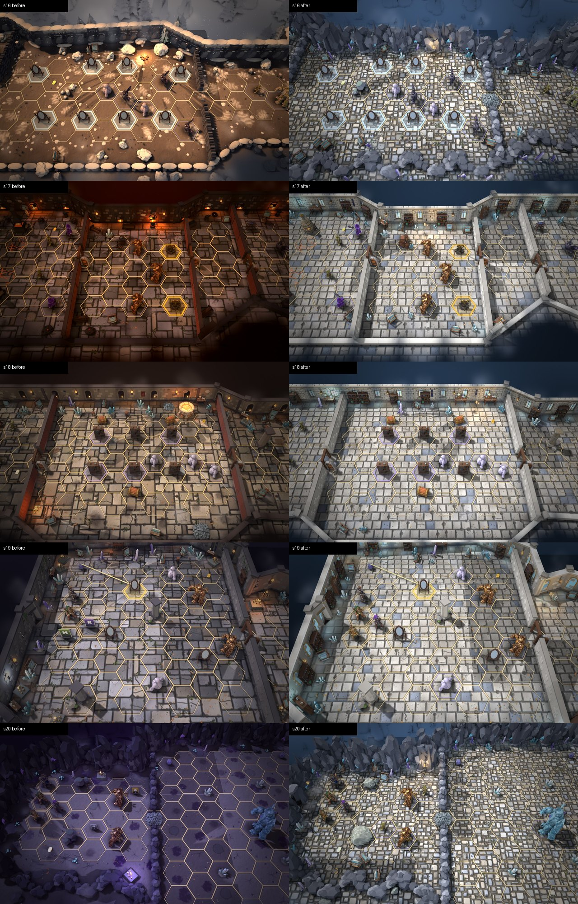

# Скляне місто (s16–s20): нове оточення

Раніше дошки Скляного міста брали чужі локації: s17 — кузню, s18 — підвал, s19 — вежу, s16 — засніжений перевал, s20 — фіолетову печеру. Тепер у міста дві свої локації. План і причини — у [PLAN.md](PLAN.md), що лишилось — у [HANDOFF.md](HANDOFF.md).

## Що змінилось

- **`glass-town`** (s17, s18, s19, приміщення):
  - **Стіни.** Новий край `glass`: світлий вапняк тесаними рядами, латунний пояс під карнизом, пілястри. Кожен другий сегмент — високе вітражне вікно в латунній рамі. На стінах латунні ліхтарі замість смолоскипів.
  - **Підлога** `glass-tiles` — полірована світла плитка, зрідка сиво-блакитний сланець, без моху.
  - **Світло** денне й холодне. Під вітражами на підлозі бірюзові та бурштинові плями світла. У повітрі скляний пил, туман синьо-бірюзовий.
  - **Оздоблення.** Полиці зі склом, книжкові шафи, верстаки склодува, кристали, шибки, скляні ліхтарі на стовпах. У s17 замість ковальського горна стоїть склодувна піч.
- **`glass-heights`** (s16, s20, надворі): світла скеля з кристалами, бруківка, денне світло, скляні пропи й ліхтарі.
  - Стін будинку тут немає за правилом «кімната або в приміщенні, або надворі» (`tests/data/zones.test.ts`).
- **Розбите дзеркало** (`mirror-broken`) тепер стоїть із тріснутим склом: радіальні тріщини, дірка з темною дошкою, скалки на підлозі. Раніше воно лежало перекинуте. Перевірка: [check-mirror-broken-zoom.jpg](check-mirror-broken-zoom.jpg).
- **Шибки візка** в s16 у грі прозорі: крізь скло видно фетр і раму. Перевірка: [check-cart-panes.jpg](check-cart-panes.jpg).

## Нові моделі з Blender

Усі зроблено через MCP, крок за кроком, з переглядом після кожного кроку. Кожна має запечені з high-poly колір, metal-rough і normal 1024. Сцена `art/blender/act3-props/act3-props-hq.blend`, колекція `gt`.

| Модель | Що | Трикутники (high / low tier) |
|---|---|---|
| `env-glass-town` → `glass-window` | сегмент стіни з арковим вітражем: клинчасті камені й замковий камінь, латунна рама, свинцеві шпроси, бурштиновий медальйон; скло світиться запеченим кольором | 2104 |
| `env-glass-town` → `glass-wall` | простий сегмент у тій самій кладці: пілястра з латунним кільцем, карниз із заклепками | 1484 |
| `env-glass-town` → `glass-sconce` | латунний настінний ліхтар: щиток, завиток, шестигранний ліхтар зі світлими шибками | 840 |
| `glassware-shelf` | горіхова етажерка з латунними поручнями: графин, пляшки, кулі, пісочний годинник, колби, реторта, банки з кришками, бутель, скляні прути | 6028 / 3014 |
| `glass-furnace` | склодувна піч-«вулик» зі світлого каменю: латунні обручі, два отвори з жаром, димар із латунною шапкою, стійка зі склодувними трубками | 2094 / 1383 |
| `mirror-broken` | дзеркало v2 із тріснутим склом (уламки-грані, срібний матеріал) | 4098 / 2048 |

## Виклики малювання (debug-рядок, high, 1280×800, SwiftShader)

| Дошка | Старт: до → після | Уся мапа: до → після |
|---|---|---|
| s16 | 257 → 202 | 320 → 312 |
| s17 | 266 → 247 | 285 → 267 |
| s18 | 230 → 214 | 262 → 242 |
| s19 | 198 → 165 | 279 → 174 |
| s20 | 184 → 197 (+7 %) | 212 → 166 |

- **Виклики.** Усюди не більше межі +15 %. На чотирьох дошках їх менше, ніж було: кіт стін зливається за матеріалом, однакові пропи малюються інстансами.
- **Трикутники** стрибають залежно від камери й тіней, сирі числа — у [stats.txt](stats.txt). На s17–s20 їх стало більше: приблизно 0,47 → 0,85 млн на s17 і 0,39 → 0,91 млн на s20. Причина — детальні пропи (полиця 6k, шафа 4,3k) і кам'яні стіни. На iPad треба глянути fps; що робити, якщо просяде, — у HANDOFF.

## Кадри

`sNN-0-before.jpg` / `sNN-0-after.jpg` — вигляд на старті, `sNN-o-*.jpg` — уся мапа. «До» знято з HEAD до змін, «після» — зі знімка робочого дерева, обидва headless (SwiftShader).
