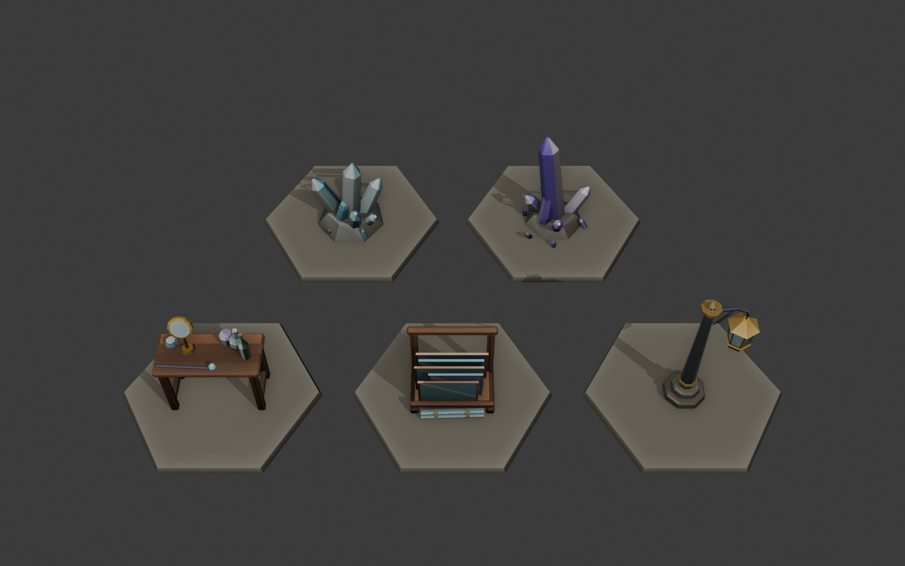

# Оздоблення кімнат Скляного міста (s16–s20)

Мапи s16–s20 беруть кіти підвалу й сторожової вежі, тож кімнати заставлено бочками та ящиками. Ці п'ять пропів роблять кімнату схожою на місто склодувів. Змодельовано в Blender через MCP: колекція `dressing` у `art/blender/act3-props/act3-props.blend`, помічники `glass_lib.py` (`crystal`, `rockbase`) і `props_lib.py`. Фарбування `paint_rich` (волокна дерева, потерті ребра, западини), вершинні кольори в sRGB.

| id | Що | Трикутники (low / medium / high) | Висота |
|---|---|---|---|
| `glass-crystals` | блакитне наростання шестигранних кристалів на кам'яній основі, дрібні уламки довкола | 619 / 641 / 641 | 0,85 |
| `glass-crystals-2` | високий бузковий шпиль із малими кристалами | 525 / 527 / 527 | 1,15 |
| `glass-lantern` | скляний шестигранний ліхтар на кованому стовпі з завитком | 556 / 656 / 656 | 1,5 |
| `glass-workbench` | верстак склодува: лінза на латунній ніжці, пляшки, стос лінз, склодувна трубка з кулькою скла | 834 / 1204 / 1204 | 1,15 |
| `glass-panes` | дерев'яний стояк, у якому п'ять шибок спираються на задній брус, попереду в'язка скляних прутів | 660 / 1088 / 1088 | 0,8 |

Дошка знаходить кожну модель за id, висоти задано в `MODEL_HEIGHT` (`src/render/propModels.ts`). Щоб покласти проп у кімнату, у таблиці `propModels` локації пишуть, наприклад, `"crate": "glass-panes"`, або ставлять його як перешкоду чи окрему деталь. Оздоблення кітів тут не змінювалося.

Модель `crystal-cluster` з Meshy вже є, тому нові кристали названо `glass-crystals`, щоб не плутати.
