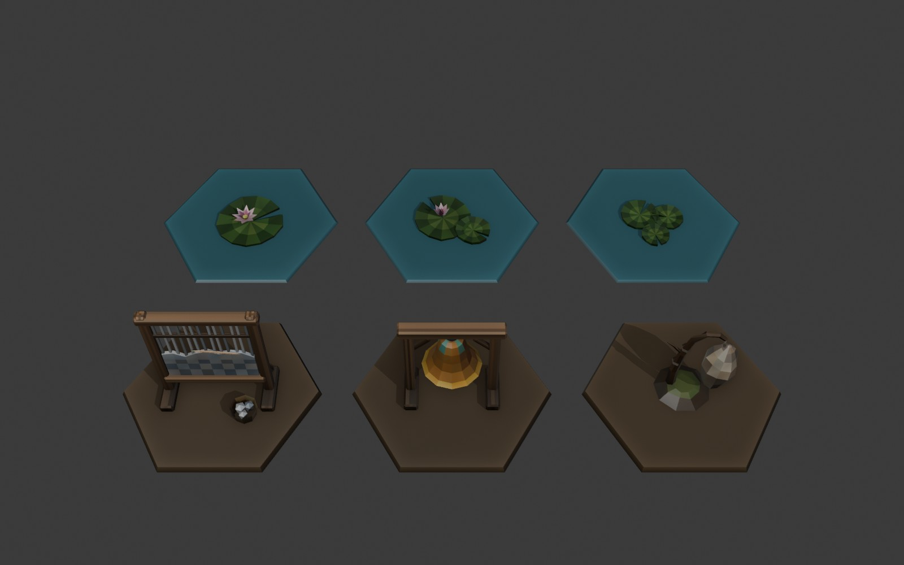

# Пропи Сонного болота (Акт III)

Змодельовано в Blender через MCP покроково, сцена та сама, що в Скляного міста: `art/blender/act3-props/act3-props.blend`, колекція `marsh`. Помічники: `props_lib.py` і `lily_lib.py` (лист і квітка латаття).

Поверхня багатша, ніж у першій партії (`paint_rich` у `props_lib.py`), і все це у вершинних кольорах, без текстур:
- **волокна дерева**: кожен брус розрізано вздовж на смуги, і кожна смуга має свій тон;
- **потерті ребра**: світлі й трохи вицвілі гострі кути фасок; западини темніші;
- **дрейф відтінку** від грані до грані та легкий шум пензля.

| id | Що | Трикутники (low / medium / high) | Висота на дошці |
|---|---|---|---|
| `loom` | туманний ткацький верстат: рама з підкосами, сірі нитки основи, сіра «тканина» з рваним верхом, човник, кошик із клубками | 798 / 1448 / 1448 | 1,3 |
| `bell` | бронзовий дзвін (виточений профіль) із зеленою патиною на плечі й натертим краєм, на короткій рамі з підкосами; язик і мотузка | 806 / 1260 / 1260 | 1,1 |
| `cocoon` | кокон молі зі спіральним шовком на гачку кривої гілки, купина з мохом | 338 / 366 / 366 | 1,0 |
| `lily-pad` | великий лист латаття з рожевою квіткою | 116 / 160 / 160 | 0,116 (своя) |
| `lily-pad-2` | два листи й напіврозкритий бутон | 160 / 252 / 252 | 0,154 (своя) |
| `lily-pad-3` | три малі листи | 210 / 336 / 336 | 0,054 (своя) |

- Дошка знаходить модель за id. Висоти задано в `MODEL_HEIGHT` (`src/render/propModels.ts`). Латаття пласке, тому його висота — власна висота моделі, і лист лишається ~0,75 завширшки. Низ листа на y = −0,012, тобто трохи під водою.
- Сценаріїв Сонного болота (s11–s15) у `data/scenarios` ще немає, тож жодна мапа ці пропи поки не ставить.

## Виправлення кольору для обох партій

Перша партія записувала hex-кольори палітри як лінійні значення, тому в грі вони виходили блідими й вигорілими. Тепер фарбування пише в `color_srgb`. Пропи Скляного міста перефарбовано, переекспортовано, і [аркуш](props.jpg) знято заново: кольори насиченіші й відповідають палітрі.
