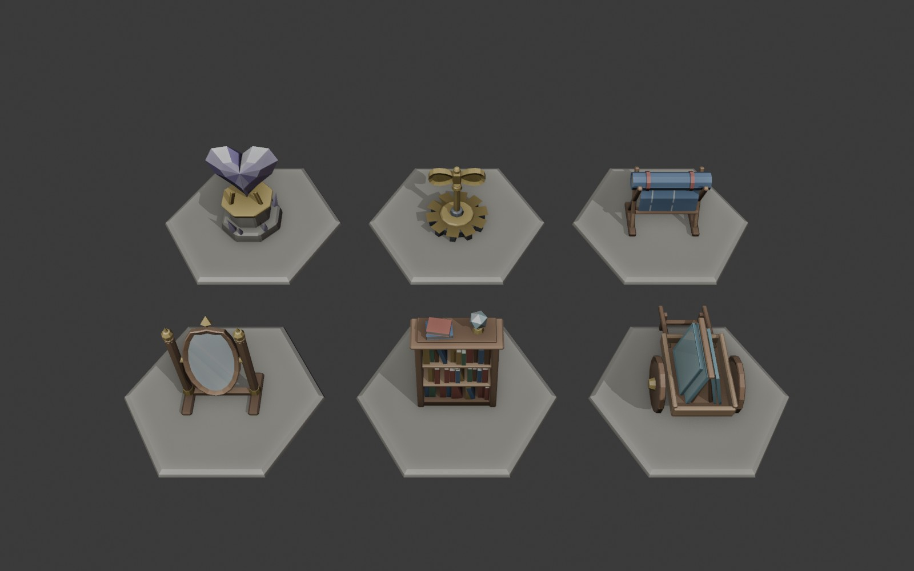

# Пропи Скляного міста (Акт III, s16–s20)

Змодельовано в Blender через MCP покроково (фаски, вставки, вирізи, перевірка `look` після кожного кроку). Колір — вершинні кольори по гранях (атрибут `Col`): основний колір частини, світліший верх, темніший низ, легкий шум пензля. Без текстур, один матеріал `glass-props` (roughness 0,85, metallic 0).

| id | Що | Трикутники (low / medium / high) | Висота на дошці | Сценарії |
|---|---|---|---|---|
| `mirror` | овальне дзеркало на двох стовпчиках із латунними навершями; скло нахилене на 22° назад, щоб його було видно згори | 716 / 840 / 840 | 1,15 | s16, s19 |
| `bookshelf` | шафа з трьома рядами книжок, на ній стос книжок і скляна куля | 948 / 1056 / 1056 | 1,35 | s18 |
| `glass-cart` | двоколісний візок Іди зі скляними шибками на рамі-«хатці», ручки й підпора ззаду | 1028 / 1376 / 1376 | 0,85 | s16 |
| `crystal-heart` | гранчасте кришталеве серце в латунних тримачах на кам'яному постаменті, дрібні кристали довкола | 528 / 552 / 552 | 1,0 | s20 |
| `wind-up-key` | заводний ключ із двома «крилами» в залізній шестерні | 890 / 1072 / 1072 | 0,85 | s17 |
| `blueprint` | рулон синього креслення на козлах, аркуш звисає вперед зі світлими лініями, червоні стрічки | 578 / 696 / 696 | 0,75 | s17 |

## Рамка й підключення

- Рамка як у пропів Meshy: низ на y = 0, центр над початком, лице до +Z (до дошки). Поворот дзеркала (3 стани) задає код.
- Файли: сцена й скрипт-помічник `art/blender/act3-props/` (`act3-props.blend`, `props_lib.py`), сирі GLB `art/meshy-source/<id>/<id>.glb`, рівні `assets/models/<id>/<id>{.low,,.hq}.glb` (`npm run models <id>`). Маніфест: `kind: "prop"`, `source: "blender"`.
- Дошка знаходить модель за id (об'єкт `mirror:dark` → `mirror`, `bookshelf`, `crystal-heart`), висоту бере з `MODEL_HEIGHT` у `src/render/propModels.ts`, якщо таблиця локації не каже інакше. Для `glass-cart`, `wind-up-key`, `blueprint` сценарій має поставити перешкоду чи об'єкт із таким id (або локація — рядок у `propModels`).
- У переглядачі `dev/models.html` з `&env=1` вершинні кольори вигорають (карта середовища там на повну силу); на дошці вона 0,45.
