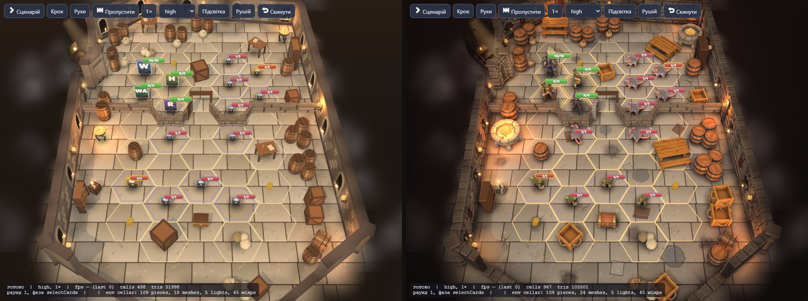
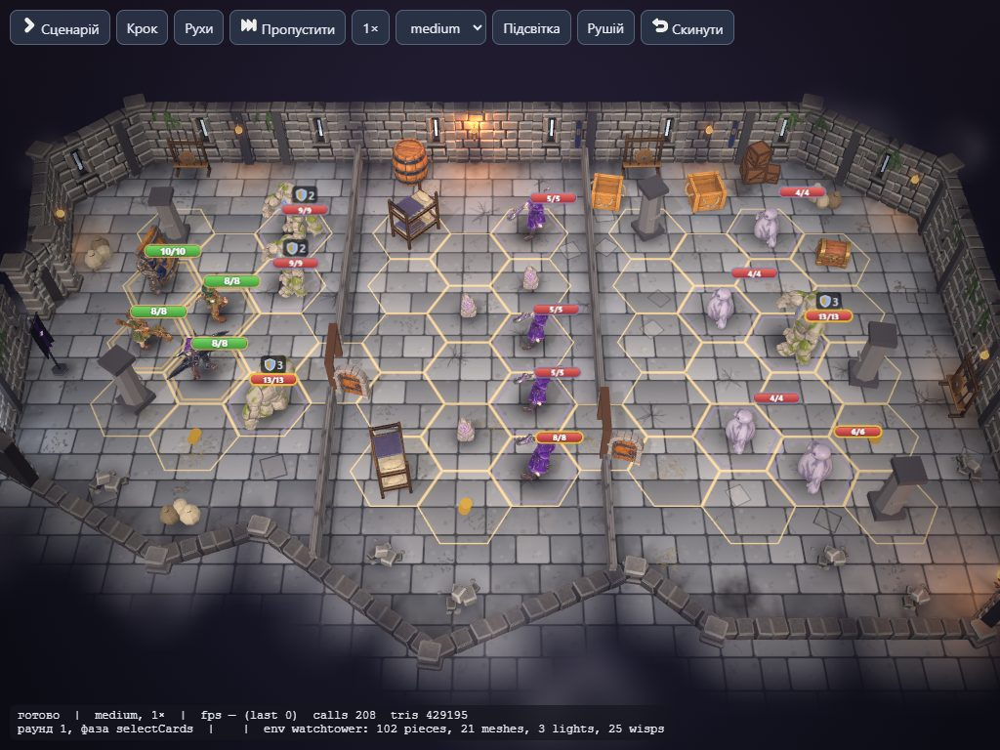
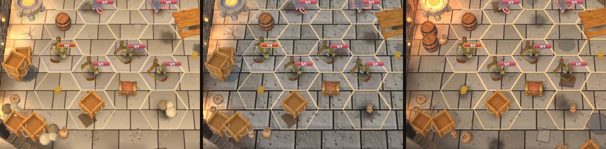

# Атмосфера локацій: світло, брудна підлога, стіни з історією

Скарга: рівні пласкі й стерильні — лише підлога та стіни, часто однакові, світло без об'єму.
Перевірка: `/vidvazhni/dev/board.html?board=s1..s5&quality=low|medium|high`.

## Що зроблено

| Що | Як | Де |
|---|---|---|
| Тепле проти холодного | ключове світло й заповнення неба холодні та тьмяніші; факели, свічки й жаровні тепліші й сильніші (7 замість 5, радіус 7) | `data/environments/*.json` (`light`) |
| Теплі плями світла | під кожним полум'ям на підлозі адитивна пляма кольору вогню, мерехтить разом із ним; гасне під завісою нерозкритої кімнати. На low це єдине тепле світло (точкових світел 0), на medium/high — слабша, поверх справжніх ламп | `decals.ts` (`buildPools`), 1 виклик |
| Затінення (AO) | high: GTAO по екрану (прозоре, вогонь і туман не враховуються); усі рівні: темніша смуга біля ніг стін + плавне затемнення останніх двох гексів до країв кімнати (поле `A`), контактні тіні під пропами | `post.ts`, `field.ts` |
| Грейдинг і віньєтка | для кожної локації: тінь (lift), світло (gain), насиченість, контраст; темніші краї екрана, трохи сильніше вгорі (дальня стіна) | `atmosphere.ts` (`grade`), `post.ts` — medium і high |
| Брудна підлога | плями, тріщини, калюжі (глянцеві), солома, листя, камінці, коріння, мох, слиз, кіптява, пил, інша плита чи дошки; ~1 декаль на гекс; уздовж стін і перегородок смуга бруду. Насіння — сценарій, тож між завантаженнями все на місці | `decals.ts` (`buildFloor`), 2 виклики |
| Стіни з історією | варіанти сегмента: виступні камені, цоколь, контрфорс, балка (дерево); декалі: вологі плями, патьоки, павутина в кутах, гобелен, віконце з ґратами, тиньк; плющ, тріщини, прапори, бійниці; мох і лінія води; слиз; кіптява над кожним факелом. Великі речі (гобелен, вікно, прапор, бійниця) не частіше ніж через дві стіни | `decals.ts` (`buildWalls`), 2 виклики + 1–3 на варіанти |

Набір для кожної локації — таблиця `ATMOSPHERE` в `src/render/environment/atmosphere.ts`:

| Локація | Підлога | Стіни |
|---|---|---|
| підвал (s1) | плями, солома, тріщини, камінці, плити, калюжі, дошки, кіптява | павутина, вологість, патьоки, тиньк, гобелен, віконце, тріщини |
| тернова стежка (s2) | листя, коріння, камінці, мох | (стін немає; якщо з'являться — плющ, тріщини, мох) |
| затоплений млин (s3) | калюжі, мох, плями, солома, листя | мох, лінія води, вологість, патьоки, павутина; балки |
| сторожова вежа (s4) | тріщини, пил, щебінь, плити, камінці | тріщини, плющ, прапори, бійниці, кіптява; контрфорси |
| серце Мороку (s5) | слиз, тріщини, камінці, плями | (скельні стіни — без декалей); слиз на підлозі вздовж краю |

**Ціна.** Шість-вісім викликів малювання на локацію (декалі злиті в меші, плями — інстанси). Атласи 512×512 малюються в коді один раз (~30 мс). Medium: +1 повноекранний прохід (грейд). High: GTAO ще раз малює сцену в нормалі — найдорожче; на s2 (1,7 млн трикутників) помітно. Low без пост-обробки.

### Рельєф підлоги

Підлога більше не «кахель»: з її власної текстури (`relief.ts`) виводиться висота — шви й тріщини темніші, отже нижчі; широке розмиття яскравості й тайловий шум піднімають і нахиляють плити, дрібний шум дає вибоїни. З висоти — нормалі, затінення в заглибинах (AO швів) і знос: високий відкритий камінь трохи блищить, шви й підніжжя стін матові.

| | low | medium | high |
|---|---|---|---|
| нормалі (світло факелів ковзає по фасках) | ні | так | так |
| AO у швах, знос (roughness) | запечено в колір | так | так |
| паралакс (плити зміщуються з кутом огляду) | ні | ні | так |
| «псевдосвітло» зліва згори, запечене в текстуру | так | ні | ні |

Ціна: одна текстура 512 px на локацію, рахується при побудові (~40 мс), одна вибірка в шейдері підлоги (дві на high).

## Заглушки, які варто замінити

Усі декалі зараз намальовані процедурно в `decals.ts` (два атласи 4×4 клітинки по 128 px). Кращі текстури підставляються в ту саму клітинку без змін розміщення.

### ChatGPT: текстури (прозорі PNG-декалі, без тексту)

Формат: квадрат 512 px, прозорий фон, вид строго згори (підлога) чи фронтально (стіна), рівне матове світло без тіні від джерела, без відблисків, нічого не торкається краю (≥ 16 px поля). Стиль — як `art/prompts/ui/STYLE-LOCK.md`.

| Файл | Що | Клітинка |
|---|---|---|
| `decal-floor-stain.png` | темна пляма бруду з рваним краєм, сіро-біла (тонується в коді) | floor 0 |
| `decal-floor-crack.png` | тріщина в камені, що розходиться променями | floor 1 |
| `decal-floor-puddle.png` | неглибока калюжа з брудною облямівкою | floor 2 |
| `decal-floor-straw.png` | розкидана солома | floor 3 |
| `decal-floor-leaves.png` | опале листя (руде, буре, оливкове) | floor 4 |
| `decal-floor-debris.png` | дрібні камінці й тиньк | floor 5 |
| `decal-floor-planks.png` | 3 старі дошки, покладені на підлогу | floor 7 |
| `decal-floor-moss.png` | плями моху | floor 8 |
| `decal-floor-slime.png` | фіолетово-чорний слиз Мороку | floor 9 |
| `decal-floor-roots.png` | коріння, що вилізло з-під каменю | floor 12 |
| `decal-floor-edge-dirt.png` | смуга бруду біля стіни, темна знизу, зникає догори; 1024×256 | floor 14 |
| `decal-wall-damp.png` | волога пляма з солоною облямівкою | wall 0 |
| `decal-wall-drips.png` | патьоки води згори | wall 1 |
| `decal-wall-cobweb.png` | павутина в лівому верхньому куті | wall 2 |
| `decal-wall-tapestry.png` | гобелен корчми (теплий червоний, золота кайма, без тексту й облич) | wall 3 |
| `decal-wall-window.png` | маленьке віконце з ґратами під стелею підвалу | wall 4 |
| `decal-wall-ivy.png` | плющ, що звисає згори | wall 5 |
| `decal-wall-banner.png` | синій прапор варти з простою золотою емблемою, хвіст «ластівкою» | wall 7 |
| `decal-wall-stained-glass.png` | вітраж для руїн каплиці (на майбутнє) | — |
| `decal-wall-watermark.png` | лінія води й темніша частина нижче | wall 10 |
| `decal-wall-slime.png` | слиз, що стікає згори | wall 11 |
| `decal-wall-soot.png` | кіптява над факелом, догори ширшає | wall 12 |

### Meshy: моделі

| Модель | Навіщо | Висота |
|---|---|---|
| `wall-sconce-candles` | залізний кронштейн із 3 свічками на стіну підвалу | ~0,4 |
| `wall-shelf-jars` | настінна полиця з глеками й пляшками | ~0,5 |
| `wall-chains` | ланцюги з кільцями на стіні | ~0,8 |
| `barred-window` | віконце з ґратами, об'ємне, на місці декалі | ~0,45 |
| `banner-pole` | прапор на древку для вежі | ~1,4 |
| `ivy-hanging` | плющ об'ємним пасмом для руїн | ~1,2 |
| `rubble-wall-breach` | пролом у стіні з камінням (варіант сегмента) | ~1,6 |
| `mill-beam-wall` | дерев'яна стійка з підкосом для зали млина | ~1,5 |
| `gloom-tendril` | щупальце Мороку, що виростає зі скелі | ~1,0 |
