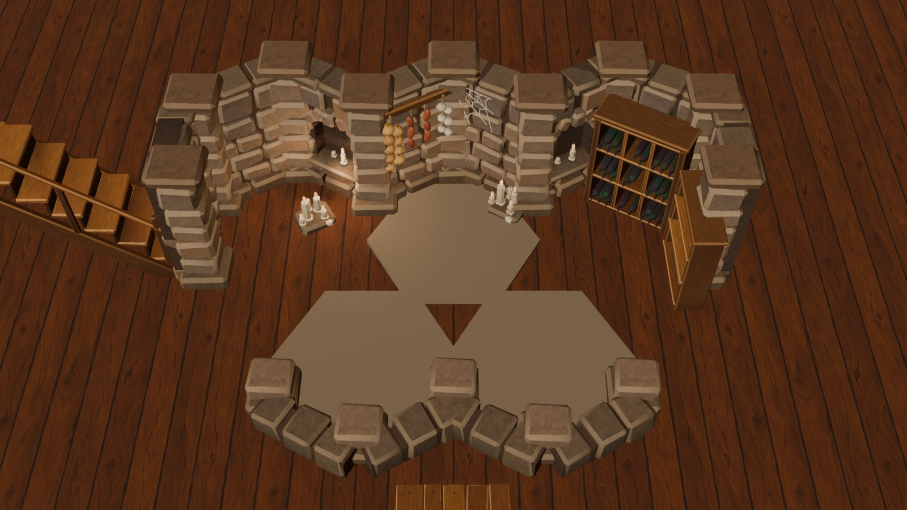
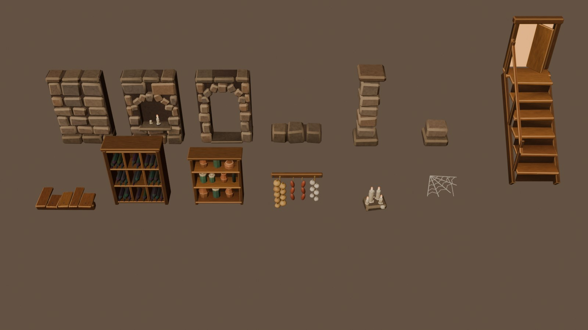

# Арт-кіт оточення (Blender)

Деталі навколо гексів (стіни, колони, проходи, сходи, полиці, рослини, скелі) змодельовано в Blender через MCP і розписано під Meshy-персонажів: масивні фаски, тепла палітра, мазки пензля, світлі верхні ребра, темні шпарини й низ. Пропи, які робить Meshy (бочка, ящик, скриня, двері, важіль, жаровня, руностовп, капкан, терновий кущ, млинове колесо, стіл, мішок, уламок ліхтаря), тут **не** дублюються.

## Файли

| Що | Де |
|---|---|
| Скрипти збирання (джерело правди) | `art/blender/env-kit/kitlib.py` (спільне), `art/blender/env-kit/<локація>.py` |
| Сцени Blender | `art/blender/env-kit/<локація>.blend` (колекції `<локація>` і `<локація>-diorama`) |
| Сирий GLB і атлас 2048 px (поза git) | `art/meshy-source/env-<локація>/env-<локація>.glb`, `env-<локація>-atlas.png` |
| Готові рівні | `assets/models/env-<локація>/env-<локація>{.low,,.hq}.glb` (`npm run models env-<локація>`) |
| Маніфест | `art/prompts/manifest.json`, `kind: "environment"`, `source: "blender"` |
| Знімки | `docs/art/env-kit/<локація>-kit.jpg` (усі деталі), `<локація>-diorama.jpg` (деталі навколо гексів у ракурсі гри) |

## Як влаштований GLB (для дошки)

**Один GLB на локацію, а не на деталь.** Усі деталі локації ділять один атлас, тож у відеопамʼяті одна текстура на локацію (а не 13 копій), і дошка може зливати їх в один виклик малювання на матеріал.

- Кожна деталь — окремий вузол верхнього рівня, **ім'я вузла = kit id** з таблиць нижче (`stone-wall`, `stairs`, …). Ім'я меша те саме.
- Рамка деталі та сама, що в `src/render/environment/README.md`: 1 одиниця = гекс від центру до кута; початок координат унизу по центру; деталь «дивиться» на +Z (до дошки); стіни йдуть уздовж X, довжина 1,06, внутрішня грань на z = 0, тіло позаду (−Z).
- **Трансформ вузла не одиничний.** Стиснення meshopt квантує позиції й переносить зсув і масштаб у вузол (у `stone-wall` це T = (0; 0,80; −0,14), S = 0,81). Тож брати треба світову матрицю вузла відносно сцени (як `loadKitPiece` з `matrixWorld`), а не лише геометрію. Якщо клонувати вузол, його локальний трансформ лишається, і клон кладеться в групу, що стоїть у місці деталі.
- Масштабувати не треба: деталі вже в одиницях гекса, а стіни мають висоту `walls.height` своєї локації (підвал 1,6). Вирівнювання за `height`, як у `propModels` для пропів Meshy, для кіт-деталей зайве.
- Матеріали: `env-<локація>` (атлас як base color, roughness 0,88, metallic 0) і `env-<локація>-glow` (той самий атлас як base color і emissive, для полум'я свічок і світла у дверях). Деталь має один-два примітиви.
- Текстури за рівнями: low 512², medium 1024², high 2048² (WebP).
- Низ деталей, що стоять на підлозі, не моделювався (його ніколи не видно).

Пропозиція для `propModels` (вирішує сесія дошки): `"stone-wall": { "model": "env-cellar", "node": "stone-wall" }`.

## Підвал `env-cellar` (сценарій 1)




| kit id | Тип | Розмір X × Y × Z (Y — висота) | Трикутники | Розміщення й примітки |
|---|---|---|---|---|
| `stone-wall` | стіна | 1,06 × 1,62 × 0,40 | 934 | кам'яна кладка: цоколь, ряди каменю, плити зверху; тіло z від −0,34 до 0, камінь виступає до +0,06 |
| `stone-arch` | стіна | 1,06 × 1,62 × 0,41 | 1 458 | ніша з аркою та двома свічками на підвіконні; полум'я в (0,06; 0,63; −0,08) |
| `stone-wall-low` | низька стіна | 1,05 × 0,35 × 0,39 | 142 | один ряд великих каменів, для країв між камерою й дошкою |
| `stone-pillar` | кут | 0,53 × 1,73 × 0,52 | 308 | колона на вершині контуру, центр у (0; −0,1) як у процедурної |
| `stone-pillar-low` | кут | 0,50 × 0,43 × 0,51 | 88 | низька колона для низьких стін |
| `stone-doorway` | прохід | 1,18 × 1,62 × 0,41 | 1 044 | арка без дверей (двері — проп `dungeon-door` з Meshy); проріз 0,62 × 1,30, поріг |
| `stairs` | вхід | 0,95 × 2,68 × 2,03 | 832 | дерев'яні сходи вгору від дошки (у −Z), поручень ліворуч, двері в корчму прочинені й світяться; світло в (0; 1,91; −1,94) |
| `wine-rack` | проп | 1,04 × 1,36 × 0,44 | 1 892 | 9 комірок із пляшками шийками вперед; задня стінка на z = −0,36 |
| `shelf` | проп | 0,96 × 1,15 × 0,34 | 1 554 | полиця з глиняними горщиками, банками під полотном і пляшкою |
| `candles` | проп | 0,43 × 0,51 × 0,36 | 784 | п'ять свічок на камені, чотири горять; світло ≈ (−0,08; 0,47; 0,03) |
| `hanging-food` | **новий** декор стіни | 0,92 × 0,75 × 0,22 | 1 970 | в'язки цибулі й часнику та ковбаси на рейці; ставиться **тим самим трансформом, що й стіна**, висить перед її гранню (z від 0 до +0,22), верх на висоті 1,43 |
| `cobweb` | **новий** декор стіни | 0,52 × 0,52 × 0 | 78 | павутина в лівому верхньому куті грані стіни (z = +0,03); для правого кута дзеркалити `scale.x = −1` |
| `floor-edge` | **новий** край підлоги | 1,11 × 0,19 × 0,55 | 364 | обірвані дошки підлоги на балці, вздовж X; дошки йдуть у −Z (від балки на z ≈ 0 до −0,55), верх на y ≈ 0,03 — для краю, де підлога підвалу кінчається в темряві |

Разом 11 448 трикутників (low 10 206), атлас 2048². Розміри файлів: low 0,32 МБ, medium 0,45 МБ, high 0,71 МБ.

Пропи кільця `barrel`, `crate`, `sack` і `chest`/`door`/`trap` бере Meshy; `keg-rack`, `crate-stack`, `sacks` лишаються процедурними або збираються дошкою з моделей Meshy.

## Як перезібрати локацію

Лише через Blender MCP (`execute_blender_code`), кожен крок перевіряти `look`:

```python
exec(open(r'C:\Braves\art\blender\env-kit\kitlib.py', encoding='utf8').read())
exec(open(r'C:\Braves\art\blender\env-kit\cellar.py', encoding='utf8').read())
clear_scene(); view_setup()
objs = build_cellar()                                  # деталі з атрибутами rnd/edge/ao/cvx
unwrap_and_pack(objs)                                  # UV 'atlas': smart project, менше місця для спинок і споду, пакування AABB
img = bake_atlas(objs, 'env-cellar-atlas', size=2048)  # Cycles EMIT, ~40 с на CPU
preview(objs, 'cellar', img)                           # ігровий матеріал у в'юпорті
export_location('cellar', objs, r'C:\Braves\art\meshy-source\env-cellar\env-cellar.glb')
```

Далі `npm run models env-cellar` і `npx vitest run tests/models -t env-cellar`.

**Як «розписано».** Кожна частина отримує випадкове число `rnd` (відтінок з 2–3 кольорів фарби), фаски — прапорець `edge` (світле ребро, сильніше згори), вершини — `ao` (частка коротких променів, що влучили в деталь: шпарини) і `cvx` (опуклість, для каменів і плодів). Шейдер запікання додає мазки (шум, витягнутий уздовж волокна), смуги деревини, рідкі тріщини на камені, світліший верх і темніший низ (перші 0,3 над підлогою). Усе це запікається в атлас без трасування AO, тому запікання швидке.
