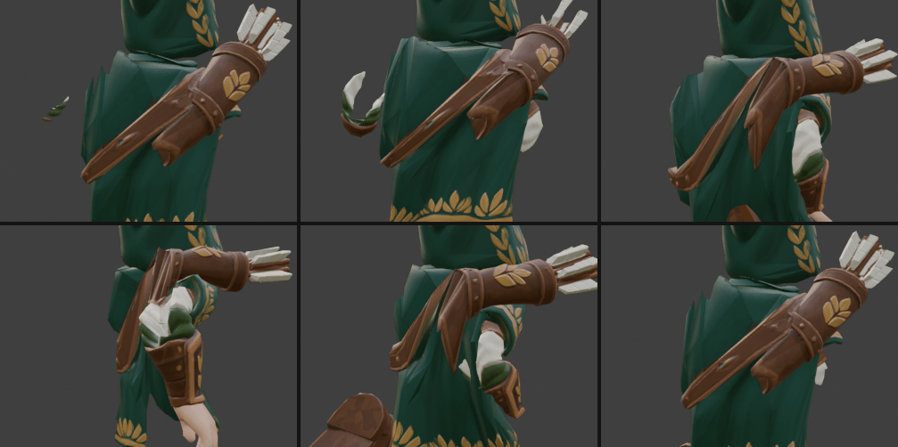
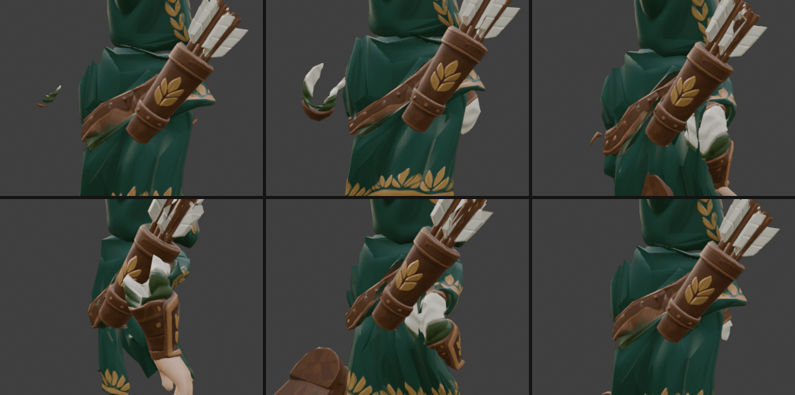
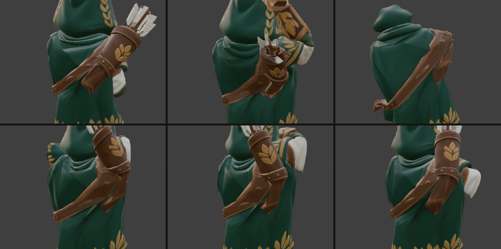
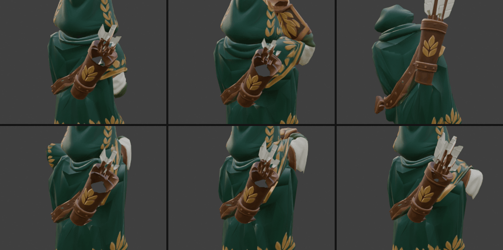
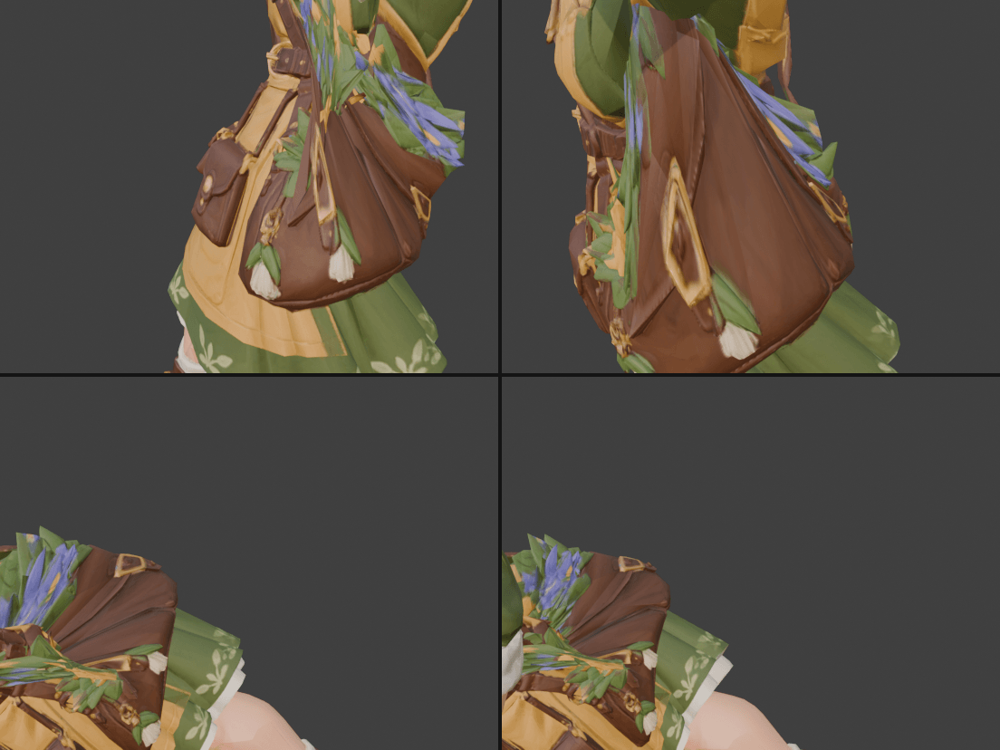
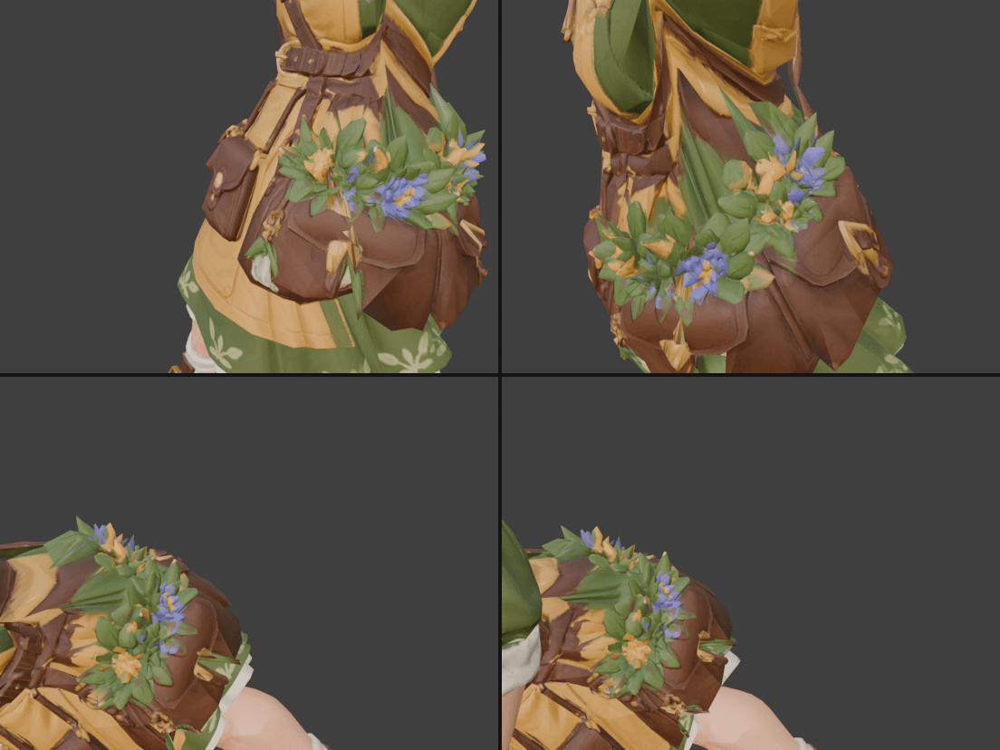
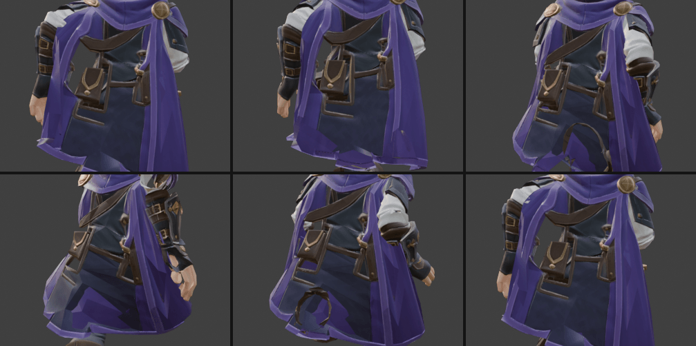
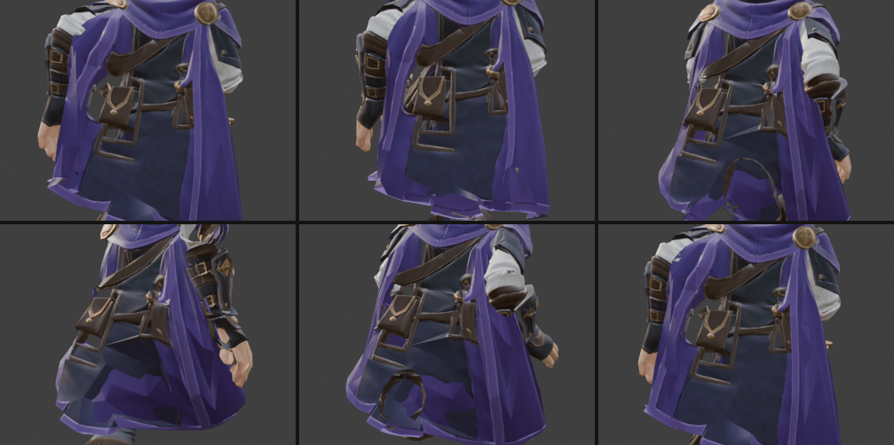

# Жорсткі аксесуари на одязі: сагайдак, сумки, підсумки

Meshy віддає персонажа одним скіненим мешем, і автоматичний риг роздає ваги за відстанню до кісток. Через це предмет, що лежить на тканині, отримує ваги тканини під ним і гнеться разом із нею. Лучниця (`wind-archer`), травниця (`herbalist`) і розбійниця (`rogue`) виправлені, інші моделі перевірені. Нижче описано, що було не так, рецепт ваг і результати перевірки.

**Захищені копії.** Виправлений сирий файл лежить у двох місцях: `art/meshy-source/<id>/<id>.glb` (з нього збирає `npm run models`) і `<id>.rigged-fix.glb` (копія, яку інші скрипти не перезаписують). Якщо `<id>.glb` колись затреться, досить скопіювати `<id>.rigged-fix.glb` назад. Оригінал Meshy — `<id>.meshy.glb`. Травницю довелося виправляти двічі: скрипт заповнення тріщин узяв за вхід `herbalist.meshy.glb` і затер `herbalist.glb` з першим виправленням.

Усю роботу в Blender 5.2 виконано через MCP (`execute_blender_code` + `look`). Blender зі shell чи фонові скрипти не запускалися.

## Що було не так

**Лучниця.** Сагайдак зі стрілами за правим плечем мав ваги 65 % `RightArm`, 21 % `RightShoulder`, 10 % `Head`. Нижня частина, що лежить на плащі, отримала ще й `RightUpLeg` і `Hips`. Тому в бігу сагайдак розгойдувався за рукою, а нижня частина відставала і рвалася надвоє, як клапоть тканини. Ремінь від сагайдака до сумки на лівому стегні теж висів на `RightArm` і `LeftUpLeg` і відлітав від тіла.






**Травниця.** Велика сумка з травами на лівому стегні мала ваги 35 % `Spine`, 30 % `Hips`, 18 % `LeftForeArm`, 15 % `LeftUpLeg`. Ліва кисть звисає над сумкою, тому сумка тягнулася за передпліччям. В `Attack`, коли руки підняті, вона витягувалася вгору довгим трикутником.




**Розбійниця.** Дві сумки на поясі ззаду разом зі шкіряними петлями й рамками під ними лежать поверх плаща. Їхні ваги — кістки плаща `Bone_020`/`Bone_021` плюс обидва `UpLeg`, тому вони гнулися й перекошувалися. Кинджали в піхвах спереду (≈90 % на своєму `UpLeg`) гнулися слабше, до 9 см.




### Наскільки предмет гнеться

Метрика: для вершин предмета на кожному кадрі шукається найкраще жорстке перетворення від пози спокою (Procrustes/Kabsch), і береться найбільше відхилення вершини від нього. У жорсткого предмета воно дорівнює 0.

| Модель, предмет | Кліп | До | Після |
|---|---|---|---|
| `wind-archer`, сагайдак і стріли (1 878 вершин) | Running | 25,5 см | 0 |
| | Archery_Shot | 20,7 см | 0 |
| | Hit_Reaction | 24,7 см | 0 |
| | Dead | 23,5 см | 0 |
| `herbalist`, сумка з травами (4 634 вершини) | Attack | 42,7 см | 0 |
| | Running | 17,4 см | 0 |
| | Hit_Reaction | 19,3 см | 0 |
| | Dead | 23,3 см | 0 |
| `rogue`, сумки й рамки ззаду (1 075 вершин) | Thrust_Slash | 20,6 см | 0 |
| | Running | 15,0 см | 0 |
| | Dead | 24,7 см | 0 |
| `rogue`, кинджали (594 + 576 вершин) | Thrust_Slash | 9,0 / 2,9 см | 0 |

## Рецепт ваг

1. **Ядро предмета** → вага 1,0 на одну кістку, решта 0:
   - на спині чи за плечем (сагайдак, рюкзак) — `mixamorig:Spine2`;
   - на поясі чи стегні (сумки, підсумки, піхви) — `mixamorig:Hips`;
   - на голові (окуляри, вінок) — `mixamorig:Head` (у перевірених моделях так уже є);
   - **на плащі з власними кістками** — на кістку плаща під предметом, а не на `Hips`. У розбійниці плащ ззаду керується ланцюжком `Spine2` → `Bone_021` → `Bone_020` → …, і навколо сумок він на ~65 % `Bone_020`. Коли сумки були жорстко на `Hips`, плащ у бігу відходив назад і накривав рамки. На `Bone_020` вони лишаються на плащі й не гнуться;
   - **підвішене до пояса над стегном** (кинджали, кобура з інструментами) — на `LeftUpLeg`/`RightUpLeg` того боку. З `Hips` підняте стегно проходило б крізь лезо, а руків'я біля пояса майже не рухається, бо воно поруч із кульшовим суглобом.
2. **Ремінь через тіло** (лучниця): вага за висотою вздовж хребта, `Hips` (z 0,90) → `Spine` (1,00) → `Spine1` (1,08) → `Spine2` (1,16), лінійно між вузлами. Біля нижнього кінця, де ремінь заходить у сумку, до 50 % лишається від старих ваг, щоб не було розриву. У розбійниці ремінь від плеча до пояса йде від `Bone_020` (z 1,06, там, де він входить у пояс із сумками) через `Spine1` (1,165) до `Spine2` (1,266).
3. **Шов.** Три кільця сусідніх вершин навколо ядра (за ребрами меша) змішуються з вагою ядра: 65 %, 40 % і 18 %, решта лишається від старих ваг. Решта тканини не змінюється.
4. **Близнюки на UV-швах.** glTF розділяє вершини на швах UV, тож в одній точці лежать 2–3 вершини. Вони мають отримати однакові ваги, інакше меш у русі розходиться на гострі уламки. Перша спроба на лучниці саме так і зламала плащ: ремінь відбирався за кольором текстури, а колір у близнюків різний. Тепер виділення доповнюється до цілих груп близнюків, а ваги в кожній групі усереднюються.

## Як знайти предмет у суцільному меші

Меш від Meshy — один острів, тож виділяти доводиться за положенням, кольором текстури і зв'язністю. Кожне виділення перевіряється `look` у кольорах вершин (атрибут `qdbg`, режим Solid → Attribute).

- **Колір вершини** береться з базової текстури за UV (`image.pixels`). Шкіра, ремені й трави добре розділяються за відтінком HSV: коричнева шкіра має відтінок 5–38°, яскравість < 0,7, насиченість > 0,3.
- **Сагайдак** — циліндр навколо осі від дна до горловини (лучниця: від (−0,13; 0,125; 1,00) до (−0,255; 0,15; 1,295)), радіус 7,5 см. Далі виділення розширюється за ребрами на вершини до 11 см, але лише ті, чия нормаль дивиться від осі (`dot(n, радіальний напрям) > 0,25`). Плащ під сагайдаком дивиться на вісь, тому не потрапляє. Стріли додаються ростом від горловини в зоні до 30 см вище.
- **Сумка травниці**: найбільша зв'язна група коричневих вершин у рамці стегна. Від неї виділення росте за ребрами на коричневі вершини (крім пояса на талії) і на трави над сумкою. Вершини, де домінує кістка руки, не додаються.
- **Пастки:** рамка навколо стегна чи плеча зачіпає руку в A-позі; трави біля кисті мають ваги руки, тому для них фільтр «рука домінує» треба зняти й обмежити x; `look` з `target` на порожньому обʼєкті ріже модель ближньою площиною відсікання (камера ставить clip за розміром цілі), тож націлюватися краще на меш із `distance`.

## Експорт

```python
bpy.ops.export_scene.gltf(filepath=..., export_format='GLB', use_selection=True,
    export_animation_mode='ACTIONS', export_force_sampling=True,
    export_optimize_animation_size=True, export_optimize_animation_keep_anim_armature=False)
```

Без `export_optimize_animation_size` Blender пише ще й канали `scale` для кожної кістки, і кожен рівень у `assets/models` важчає на 60–90 КБ. Якщо сирий файл уже раз пройшов через Blender, сталі криві `.scale` (усі ключі = 1) треба видалити з дій перед експортом. З цими налаштуваннями розміри такі самі, як були, або менші:

| Модель | low | medium | high |
|---|---|---|---|
| `wind-archer` | 718 → 717 КБ | 1 279 → 1 278 КБ | 2 584 → 2 583 КБ |
| `herbalist` | 938 → 933 КБ | 1 664 → 1 651 КБ | 3 382 → 3 369 КБ |

**Тріщини треба заповнити знову після Blender.** Скрипт заповнення тріщин (`fillholes.mjs` у спільній теці нотаток сесій) закриває T-подібні стики виродженими трикутниками з наявних вершин. Імпортер glTF у Blender такі трикутники відкидає: у розбійниці після експорту тріщин знову стало 18 замість 2. Тому після експорту з Blender: `node fillholes.mjs <експорт>.glb art/meshy-source/<id>/<id>.glb`, потім скопіювати результат у `<id>.rigged-fix.glb`. Скрипт змінює лише індекси трикутників, тож ваги й анімації лишаються (перевірено повторним імпортом: відхилення сумок і кинджалів 0). Підсумок: `rogue` — 2 тріщини (як після першого заповнення), `herbalist` — 24 із 43 (решта — великі відкриті петлі, які скрипт пропускає).

Експортер лишає 4 найбільші впливи на вершину й нормалізує їх (на шві їх буває до 7). Кінці кліпів округлюються до цілого кадру (71,2 → 71). Оригінали Meshy збережено поруч: `art/meshy-source/<id>/<id>.meshy.glb`. Після експорту: `npm run models <id>`, `npx vitest run tests/models`.

## Перевірені моделі

| Модель | Предмет | Ваги до | Відхилення (найбільше) | Висновок |
|---|---|---|---|---|
| `wind-archer` | сагайдак, ремінь | `RightArm`, `RightShoulder`, `Head`, `RightUpLeg` | 25,5 см | **виправлено** (`Spine2` + градієнт хребта на ремені) |
| `herbalist` | сумка з травами | `Spine`, `Hips`, `LeftForeArm`, `LeftUpLeg` | 42,7 см | **виправлено** (`Hips`) |
| `herbalist` | вінок; кишені фартуха | `Head` 1,0; `Hips`/`Spine` | 0; 3–7 см разом із фартухом | у нормі |
| `elementalist` | підсумки з кристалами на поясі | — | 1–2,4 см | у нормі |
| `tinker` | інструменти на стегнах | `UpLeg` 0,86–0,92 | — | гойдаються зі стегном як кобура, не рвуться; у нормі |
| `tinker` | окуляри | `Head` 1,0 | 0,1 см | у нормі |
| `gremlin` | сумочка на лівому стегні | `LeftUpLeg` 0,86 | 2–4 см | у нормі |
| `rogue` | дві сумки, петлі й рамки на поясі ззаду, поверх плаща | `Bone_020`/`Bone_021` (кістки плаща) + `UpLeg` | 24,7 см | **виправлено** (`Bone_020`) |
| `rogue` | два кинджали в піхвах спереду | `UpLeg` ≈0,9 + `Hips` | 9 см | **виправлено** (`UpLeg` свого боку) |
| `rogue` | ремінь від плеча до пояса ззаду | — | — | градієнт `Bone_020` → `Spine1` → `Spine2` |

Розбійницю виправлено на файлі із заповненими тріщинами (коміт `dec7ea7`), ваги для `rogue` у `assets/models` оновлено.

## Що лишилося знати

- **Рука проходить крізь жорсткий предмет.** Раніше предмет тягнувся за рукою й уникав перетину. Тепер у лучниці права рука на замаху назад у бігу (кадр 9 із 15) на мить заходить у низ сагайдака, а в травниці кисть торкається краю сумки. З ракурсу гри (45–60° згори) це майже не видно.
- **Розбійниця в `Thrust_Slash`:** край плаща ліворуч від сумки відходить від тіла, і видно щілину. Так було й до виправлення, це поведінка плаща.
- **Плащ лучниці** під сагайдаком і довкола плечей сам має ваги рук і стегон (так його зробив Meshy). У шві він тепер частково йде за `Spine2`, а далі рухається як раніше.
