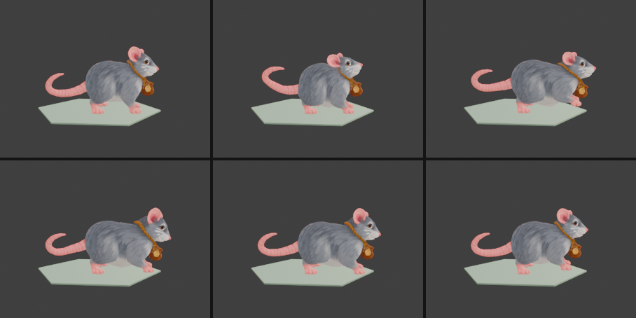
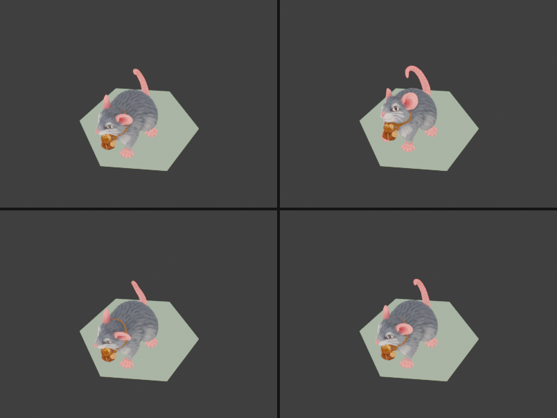
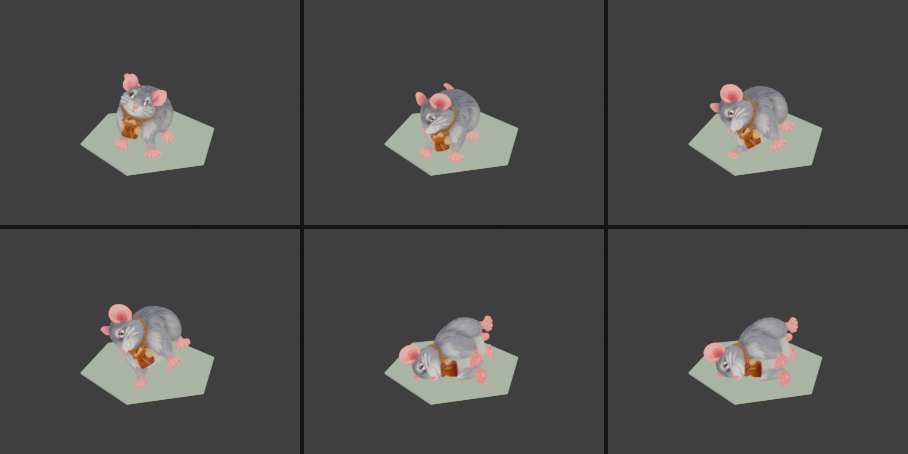
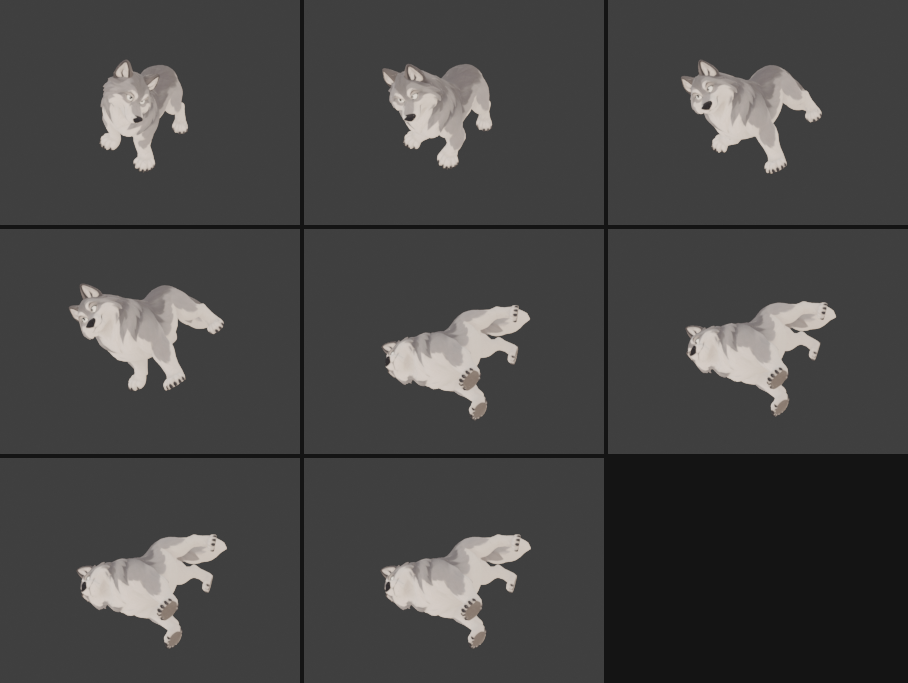
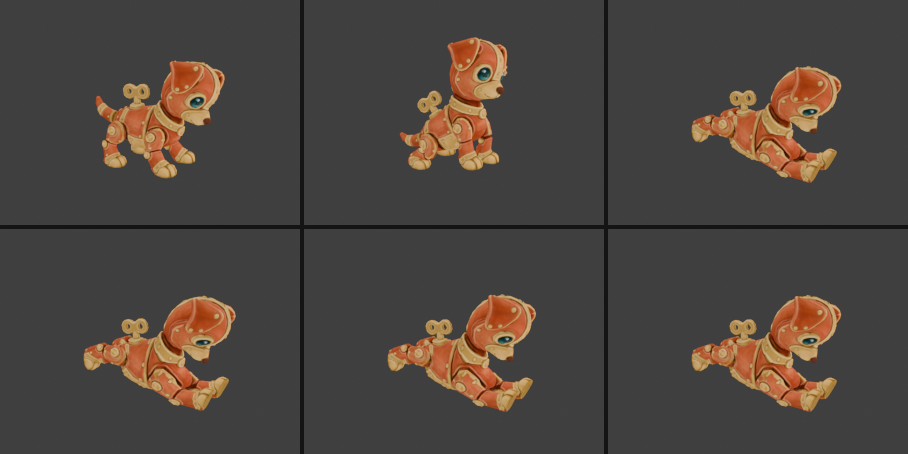

# Анімації чотирилапих: idle, attack, hit, death у Blender

Бібліотека Meshy для ригу Quadruped має лише Walking, тож решту кліпів для чотирилапих монстрів доводиться робити вручну. Першим так зроблено пацюка-злодюжку (`cellar-rat`). Нижче описано, як влаштований риг, як побудовано кожен кліп і за яким рецептом повторити це для `grey-wolf` і `tinker-button`.

Усю роботу в Blender 5.2 виконано через MCP (`execute_blender_code` + `look`). Blender зі shell чи фонові скрипти не запускалися.

## Результат

| Кліп | Тривалість | Кадри (24 fps) | Що відбувається |
|---|---|---|---|
| `idle` | 2,00 с | 0–48, цикл | дихання (2 вдихи), голова повертається ліворуч і праворуч, хвіст гойдається, двічі смикається ніс |
| `walk` | 1,00 с | 0–24 | кліп Meshy без змін (перейменовано з `Armature\|Unreal Take\|baselayer`) |
| `run` | 0,67 с | 0–16 | копія `walk`, прискорена в 1,5 раза |
| `attack` | 1,00 с | 0–24 | відкат назад і вниз, випад із піднятими передніми лапами, укус головою вниз, повернення |
| `hit` | 0,63 с | 0–15 | голова смикається вгору й убік, тіло відсахується, хвіст хльоскає, усе повертається |
| `death` | 1,50 с | 0–36 | похитування, перекидання на правий бік, відскок; фінальна поза — лежить на боці, лапи стирчать (нокаут) |

`run` у маніфесті пацюка не значиться, але `tests/models` вимагає шість кліпів для кожної моделі з ригом, тому його додано. `npm run models cellar-rat`: low 0,38 МБ / 4 120 трикутників, medium 0,59 МБ / 7 244, high 0,83 МБ / 7 244. `npx vitest run tests/models` проходить: 86 тестів.





## Риг Meshy Quadruped (27 кісток)

```
Hips ─┬─ chest ─┬─ head ─┬─ headend            (кінчик морди)
      │         │        ├─ earend, R_earend   (вуха; ваг немає або майже немає)
      │         ├─ frontleg  ─ frontleg0  ─ frontleg1  ─ frontleg2    (ліва передня)
      │         └─ R_frontleg ─ R_frontleg0 ─ R_frontleg1 ─ R_frontleg2
      ├─ tail ─ tailstart ─ tail1 ─ tail2 ─ tail3      (tail = крижі, далі хвіст)
      ├─ backleg  ─ backleg0  ─ backleg1  ─ backleg2   (ліва задня)
      └─ R_backleg ─ R_backleg0 ─ R_backleg1 ─ R_backleg2
```

- **Лапа** складається з 4 кісток: `leg` (стегно/плече) → `leg0` (гомілка) → `leg1` (плесно) → `leg2` (ступня). Голова `leg2` стоїть майже на землі.
- **Хребет горизонтальний:** `Hips` на крупі, `chest` над передніми лапами. Голова тягнеться за `chest`.
- **Ваги** (вершин із вагою > 0,3): `chest` 3 766, `head` 2 911, `Hips` 1 876, `headend` 179 (ніс, годиться для посмикування), `earend` 0, `R_earend` 30. Вуха рухаються лише разом із головою.
- **Осі в просторі арматури** (дані Y-up, обʼєкт повернутий на 90° навколо X): **+Y — угору, +Z — вперед (до морди), +X — ліворуч від пацюка.** У світі Blender пацюк дивиться в −Y.
  - обертання навколо +X: морда вниз (а хвіст, що дивиться назад, піднімається);
  - навколо +Y: поворот ліворуч;
  - навколо +Z: крен, правий бік униз.
- **Масштаб:** обʼєкт `Armature` має scale 0,01 (пацюк заввишки 1 см). Для роботи я ставив scale 1, а перед експортом повернув 0,01, щоб вузли GLB лишилися такими самими, як у сирому файлі.
- **Базова поза.** У `walk` `Hips` має location (−0,065; 0,121; ≈0,005) у локальних осях кістки: так пацюк центрується над початком координат. У позі спокою найнижча вершина на 2,7 см вище землі, тому в нових кліпах `Hips` має location (−0,065; 0,121; 0,027). Локальна Z кістки `Hips` дивиться вниз.
- Імпортер створює для кісток форму `Icosphere` у колекції `glTF_not_exported`, а «хвости» кісток величезні, бо glTF не зберігає довжин. `look` треба наводити на меш (`target: ["char1"]`), а не на арматуру.

## Як побудовано кліпи

### Пози задаються дельтами в осях арматури

Кожен кліп описаний списком ключів `(кадр, параметри, згладжування)`. Параметри такі:

- `кістка: (x°, y°, z°)` — обертання навколо осей арматури з поправкою на орієнтацію кістки: `q = Rrest⁻¹ · R · Rrest`;
- `loc` — зсув `Hips` в осях арматури. Лише по вертикалі: конвеєр (`lockRootMotion`) однаково обнуляє горизонтальний рух кореня в усіх кліпах, крім walk/run;
- `bloc:chest` — зсув `chest`. Ним зроблено випад і відсахування: тіло розтягується й стискається, як у мультфільмі, а корінь лишається на гексі;
- `ft:<лапа>` — зсув цілі ступні від її точки на підлозі (піднята чи винесена вперед лапа).

Між ключами параметри інтерполюються (smoothstep, `in`, `out`, лінійно), і поза запікається **на кожен кадр**: усі кістки отримують ключі `rotation_quaternion` і `location`.

### Лапи на підлозі

Після кожної пози лапи «приклеюються» до своїх точок на підлозі:

1. Нижній сегмент (`leg1` + `leg2`) зберігає орієнтацію спокою в просторі арматури, тож подушечки лишаються пласкими.
2. CCD на двох суглобах (`leg0`, потім `leg`) підводить голову `leg1` у точку `ціль − (rest leg2 − rest leg1)`.

Перша спроба з CCD на трьох суглобах сильно крутила плесно, і подушечки йшли під підлогу на 5–9 см. З фіксованим нижнім сегментом відхилення не перевищує 1 см.

Для `death` вага приклеювання плавно переходить 1 → 0 (slerp між вільною й приклеєною позою кожної кістки лапи): ліві лапи відриваються на кадрах 10–15, праві на 14–20. У кадрах 8–20 після кожної пози вимірюється найнижча вершина меша, і якщо вона під землею, `Hips` піднімається.

### Ключові пози

- **idle:** нульова поза плюс синусоїди з періодами, кратними 48 кадрам (ідеальний цикл, різниця між кадрами 0 і 48 = 0). Дихання: `loc.y` ±0,007 і `chest.x` ±1,5° з періодом 24. Голова: поворот ±18°, крен ±2°, нахил −3…−6° (носом трохи вгору, щоб гаманець на шиї не торкався підлоги). Ніс (`headend`) смикається ±9° з періодом 4 кадри у вікнах 6–16 і 30–40. Хвіст: поворот 10–16° з фазовим зсувом −0,6 рад на кожну кістку.
- **attack:** 7 — `loc.y` −0,045, `chest` назад на 0,10, голова вгору −14°, хвіст угору; 11 (`out`) — `chest` вперед на 0,17 і вгору, круп угору на 5°, голова −22°, передні лапи `ft` (0; 0,12; 0,21); 13 (`in`) — укус: голова +12°, лапи опускаються на 0,19 вперед; 16 → 24 — повернення, лапи переступають назад.
- **hit:** 3 (`out`) — `chest` назад на 0,09, голова (−20°, 14°, 10°), ніс угору, хвіст `tailstart` +35°, передні лапи відриваються; 7 — перехльост у протилежний бік; 11 — затухання; 15 — нуль.
- **death:** 5 — похитування назад-ліворуч; 10 — праворуч; 15 — крен 30°; 21 (`in`) — удар об землю, крен 94°; 24 — відскок на 4 см (крен 86°); 28 → 36 — фінал: крен 90°, лапи розставлені (передні вперед на 20–25°, задні назад), голова звисла, хвіст повернутий на −16°, щоб лягти на землю поруч із тілом.

### Підводні камені

- **Хвіст тримав тіло над землею.** Після крену на 90° найнижчою точкою виявився кінчик хвоста, і тіло зависало на 19 см. Довелося перебрати кути `tailstart…tail3`, поки найнижчі вершини хвоста і тіла не вирівнялися.
- **Гаманець на шиї** в `idle` торкався підлоги, коли голова опускалася. Нахил голови тепер лише вгору.
- **`bpy.ops.wm.read_factory_settings` вимикає аддон MCP**, після чого Blender доводиться перепідключати вручну. Сцену краще чистити видаленням обʼєктів і даних.
- Експорт: `export_animation_mode='ACTIONS'`, `export_force_sampling=True`, `use_selection=True` (лише `Armature` і `char1`). Blender додає `KHR_materials_specular`/`ior`, але вони були й раніше.

## Рецепт для наступних чотирилапих (`grey-wolf`, `tinker-button`)

1. Скопіювати сирий файл: `art/meshy-source/<id>/<id>.glb` → `<id>.meshy.glb`.
2. Через MCP видалити обʼєкти й дані сцени (не `read_factory_settings`) та імпортувати GLB.
3. Прочитати кістки (`bone.head_local`, `matrix_local`) і ваги (`vertex_groups`). Імена кісток у Meshy Quadruped мають збігатися з наведеними вище, але варто перевірити: у вовка можуть бути інші вуха чи щелепа, а в Ґудзика інші лапи.
4. Поставити `Armature.scale = 1`. Узяти базову location `Hips` з першого кадру `walk`, виміряти найнижчу вершину в позі спокою й опустити базу на цю величину (у пацюка 0,027).
5. Вставити помічники з розділу нижче, підставити кути. Вовкові варто дати більшу амплітуду атаки (`chest` вперед на ≈0,25, голова −30° → +20°) і розкрити пащу, якщо є кістка щелепи. Ґудзик механічний: в `idle` пасують смикання, а не дихання, а в `death` іскри робляться не скелетом, а ефектом у грі.
6. Після кожного кліпу перевіряти `look` у режимі `frames`: збоку (`view: [-1, -0.1, 0.1]`) і в ракурсі гри (`[0.7, -1, 1.2]`). Найнижчу вершину рахувати по кадрах.
7. Перейменувати Walking на `walk`, додати `run` як копію `walk` зі стисненим часом (×2/3), повернути scale 0,01, експортувати в `art/meshy-source/<id>/<id>.glb`.
8. `npm run models <id>`, `npx vitest run tests/models`, переглянути в оглядачі: `/vidvazhni/dev/models.html?model=<id>&scale=100`.

### Помічники (для `execute_blender_code`)

Функції зберігаються в `bpy.app.driver_namespace`, щоб їх можна було викликати з наступних запитів.

```python
import bpy, math
from mathutils import Quaternion, Vector, Matrix
arm = bpy.data.objects['Armature']; ns = bpy.app.driver_namespace
REST  = {b.name: b.matrix_local.to_quaternion() for b in arm.data.bones}
RESTM = {b.name: b.matrix_local.copy() for b in arm.data.bones}
BASE_LOC = Vector((-0.065, 0.121, 0.027))          # Hips location базової пози (локальні осі)
BASE_OFF = REST['Hips'] @ BASE_LOC                  # той самий зсув в осях арматури
LEGS = [['backleg','backleg0','backleg1','backleg2'], ['R_backleg','R_backleg0','R_backleg1','R_backleg2'],
        ['frontleg','frontleg0','frontleg1','frontleg2'], ['R_frontleg','R_frontleg0','R_frontleg1','R_frontleg2']]
FOOT_T = {l[3]: RESTM[l[3]].translation + BASE_OFF for l in LEGS}   # точки ступень на підлозі
AX = {'x': Vector((1,0,0)), 'y': Vector((0,1,0)), 'z': Vector((0,0,1))}
upd = lambda: bpy.context.view_layer.update()

def arm_rot(name, v):          # дельта (x°, y°, z°) в осях арматури → локальний кватерніон кістки
    R = Quaternion()
    for ax, deg in zip('xyz', v): R = Quaternion(AX[ax], math.radians(deg)) @ R
    return REST[name].inverted() @ R @ REST[name]

def rest_orient(pb):
    h = pb.head.copy(); pb.matrix = Matrix.Translation(h) @ REST[pb.name].to_matrix().to_4x4(); upd()

def pose_from(p, plant=None):  # plant: {корінь_лапи: вага 0..1}; None = усі лапи на підлозі
    plant = plant if plant is not None else {l[0]: 1.0 for l in LEGS}
    for pb in arm.pose.bones:
        pb.rotation_mode = 'QUATERNION'; pb.rotation_quaternion = Quaternion(); pb.location = (0,0,0)
    arm.pose.bones['Hips'].location = BASE_LOC + REST['Hips'].inverted() @ p.get('loc', Vector())
    for n, v in p.items():
        if n == 'loc' or n.startswith('ft:'): continue
        if n.startswith('bloc:'): arm.pose.bones[n[5:]].location = REST[n[5:]].inverted() @ v; continue
        arm.pose.bones[n].rotation_quaternion = arm_rot(n, v)
    upd()
    for leg in LEGS:
        w = plant.get(leg[0], 0)
        if w <= 0: continue
        raw = [arm.pose.bones[n].rotation_quaternion.copy() for n in leg]
        l1 = arm.pose.bones[leg[2]]
        tgt1 = FOOT_T[leg[3]] + p.get('ft:' + leg[0], Vector()) - (RESTM[leg[3]].translation - RESTM[leg[2]].translation)
        for _ in range(12):
            for jn in (leg[1], leg[0]):                       # CCD лише на стегні й гомілці
                j = arm.pose.bones[jn]; a = l1.head - j.head; b = tgt1 - j.head
                q = a.rotation_difference(b); h = j.head.copy()
                j.matrix = Matrix.Translation(h) @ q.to_matrix().to_4x4() @ Matrix.Translation(-h) @ j.matrix; upd()
            if (l1.head - tgt1).length < 0.002: break
        rest_orient(l1); rest_orient(arm.pose.bones[leg[3]])  # плесно й ступня пласкі
        if w < 1:
            for n, r in zip(leg, raw):
                pb = arm.pose.bones[n]; pb.rotation_quaternion = r.slerp(pb.rotation_quaternion, w)
            upd()

def ease(s, k):
    return {'lin': s, 'in': s*s, 'out': 1-(1-s)**2}.get(k, s*s*(3-2*s))

def sample(keys, f):           # keys: [(кадр, {параметр: (x,y,z)}, згладжування)], відсутнє = 0
    names = set().union(*(k[1] for k in keys))
    i = next(i for i in range(len(keys)-1) if keys[i][0] <= f <= keys[i+1][0])
    (f0, p0, _), (f1, p1, e) = keys[i], keys[i+1]
    s = ease(max(0, min(1, (f-f0)/(f1-f0))), e)
    return {n: Vector(p0.get(n, (0,0,0))).lerp(Vector(p1.get(n, (0,0,0))), s) for n in names}

def bake(name, keys, end, extra=None, plant_fn=None):
    old = bpy.data.actions.get(name)
    if old: bpy.data.actions.remove(old)
    act = bpy.data.actions.new(name); act.use_fake_user = True; arm.animation_data.action = act
    for f in range(end + 1):
        p = sample(keys, f)
        for n, v in (extra(f) if extra else {}).items(): p[n] = p.get(n, Vector()) + Vector(v)
        pose_from(p, plant_fn(f) if plant_fn else None)
        for pb in arm.pose.bones:
            pb.keyframe_insert('rotation_quaternion', frame=f); pb.keyframe_insert('location', frame=f)
    act.frame_range = (0, end); act.use_frame_range = True

ns.update(globals())
```

Приклад, `hit` пацюка:

```python
bake('hit', [
  (0,  {}, 'lin'),
  (3,  {'loc': (0, .025, 0), 'bloc:chest': (0, .03, -.09), 'Hips': (-5, 0, 0), 'chest': (-8, 0, 5),
        'head': (-20, 14, 10), 'headend': (-10, 0, 0), 'tailstart': (35, 0, 0), 'tail1': (-20, 10, 0),
        'tail2': (25, -10, 0), 'tail3': (15, 0, 0), 'ft:frontleg': (0, .05, -.04), 'ft:R_frontleg': (0, .04, -.03)}, 'out'),
  (7,  {'loc': (0, -.01, 0), 'bloc:chest': (0, -.01, .02), 'Hips': (1, 0, 0), 'chest': (2, 0, -2), 'head': (6, -5, -3),
        'tailstart': (-8, 10, 0), 'tail1': (10, -15, 0), 'tail2': (-15, 15, 0), 'tail3': (-5, 10, 0)}, 'smooth'),
  (11, {'head': (-2, 2, 1), 'tailstart': (2, -4, 0), 'tail1': (-3, 5, 0), 'tail2': (4, -5, 0)}, 'smooth'),
  (15, {}, 'smooth'),
], 15)
```

## Сірий вовк (`grey-wolf`)

| Кліп | Тривалість | Кадри (24 fps) | Що відбувається |
|---|---|---|---|
| `idle` | 2,00 с | 0–48, цикл | дихання, голова повільно повертається ±12°, хвіст гойдається двічі за цикл |
| `walk` | 1,00 с | 0–24 | кліп Meshy без змін |
| `run` | 0,67 с | 0–16 | `walk` ×1,5 |
| `attack` | 1,08 с | 0–26 | присідання (7), випад з піднятими передніми лапами, `chest` вперед на 0,27 (11), укус головою вниз (13), трясіння головою (16, 19), повернення |
| `hit` | 0,63 с | 0–15 | голова смикається вгору й убік, тіло відсахується, хвіст підтискається, пружне повернення |
| `death` | 1,67 с | 0–40 | похитування (5, 10), крен 30° (15), падіння на правий бік (21), відскок (24); фінал — лежить на боці, лапи витягнуті (нокаут) |

Базова location `Hips` — (0; 0,205; 0,252). `npm run models grey-wolf`: low 0,29 МБ / 3 658 трикутників, medium 0,43 МБ / 7 318, high 0,58 МБ / 7 318.



## Ґудзик (`tinker-button`)

| Кліп | Тривалість | Кадри (24 fps) | Що відбувається |
|---|---|---|---|
| `idle` | 2,00 с | 0–48, цикл | механічне «тікання»: голова ривками нахиляється вбік і завмирає (9, 23, 40), хвіст-метроном (період 8 кадрів), легкий підскок кожні 12 кадрів |
| `walk` | 1,00 с | 0–24 | кліп Meshy без змін |
| `run` | 0,67 с | 0–16 | `walk` ×1,5 |
| `attack` | 1,25 с | 0–30 | грайливий уклін із вилянням хвоста (0–7), стрибок усіма лапами в повітря (10, +7 см), приземлення, два куси (15, 19), пружне затухання |
| `hit` | 0,63 с | 0–15 | різкий ривок голови вгору й убік, хвіст стовпчиком, далі «боїнь» з трьох затухаючих коливань |
| `death` | 2,00 с | 0–48 | завод закінчується: хвіст сповільнюється, голова опускається трьома ривками (4, 10, 18); сідає (24), падає пластом на живіт, лапи вперед і назад (32), голова пружинить і завмирає підборіддям між лапами |

Базова location `Hips` — (0,0095; 0,1322; 0,1084). `npm run models tinker-button`: low 0,37 МБ / 4 136 трикутників, medium 0,58 МБ / 7 272, high 0,88 МБ / 7 272.



Іскри й «дзинь» пружини в `death` і `hit` — справа ефектів у грі, скелет їх не дає. Ключик на спині прикріплений до тулуба і не крутиться: окремої кістки для нього немає.

## Що змінилося в рецепті після вовка й Ґудзика

`npx vitest run tests/models` проходить: 219 тестів.

- **Масштаб `Hips` у `walk`.** У вовка Meshy тримає в `walk` сталий scale `Hips` 0,7288, у Ґудзика 0,7095 (у пацюка 1). Якщо нові кліпи не ключують scale, у грі модель на 37–41 % більша в усіх кліпах, крім `walk`/`run`. Тепер помічники ставлять `Hips.scale` з `walk`, решті кісток 1, і ключують `scale` на кожному кадрі. `rest_orient` зберігає масштаб кістки (`Matrix.Diagonal(pb.matrix.to_scale())`), інакше плесно й ступні роздувалися й ішли під підлогу.
- **Точки ступень** беруться з базової пози (`pose_from({}, plant={})`, далі `head` кістки `leg1`), а не з `matrix_local + BASE_OFF`. Це правильно при будь-якому масштабі `Hips`.
- **Висота підлоги в позі смерті.** `bake(..., floor=(f0, f1))` після кожної пози на цих кадрах вимірює найнижчу вершину й піднімає `Hips`, якщо модель під землею. Для фіналу `loc` рахується наперед: поза з `loc` 0, `lowest()`, мінус ця величина (вовк −0,258).
- **Експорт лише своїх кліпів.** `export_animation_mode='ACTIONS'` вивантажує всі дії файлу, зокрема чужі (у цьому файлі були кліпи rogue від іншої сесії), а без `use_active_scene=True` — і обʼєкти з інших сцен. Тепер кожен кліп кладеться на окрему NLA-доріжку з назвою кліпу, і експорт іде з `export_animation_mode='NLA_TRACKS'`, `use_active_scene=True`, `use_selection=True`.
- **Ваги лап.** У вовка й Ґудзика частина вершин лапи має найбільшу вагу на `frontleg0` (передпліччя), тому, коли коліно згинається, пальці передніх лап заходять під підлогу на 2–3,5 см (у присіданні перед атакою та в `hit`). У ракурсі гри цього не видно; виправлення — перемалювати ваги.
- **`look` у режимі `angles`** показує поточний кадр сцени, а не останню запечену позу. Перед ним треба `scene.frame_set(n)`.

## Що варто знати грі

- Пацюк у GLB заввишки 1 см (scale 0,01 на вузлі `Armature`). В оглядачі потрібен `&scale=100`; у грі масштаб задається в `loadModel`/`object.scale`.
- У матеріалі Meshy базова текстура підключена ще й як emissive з множником 1 (так було й до цієї роботи). Через це пацюк майже не затінюється світлом дошки.
- `death` закінчується позою на правому боці. Якщо гра ставить нокаутованих монстрів на один гекс із кимось, пацюк займає ≈1,0 × 1,7 м (довжина з хвостом).
