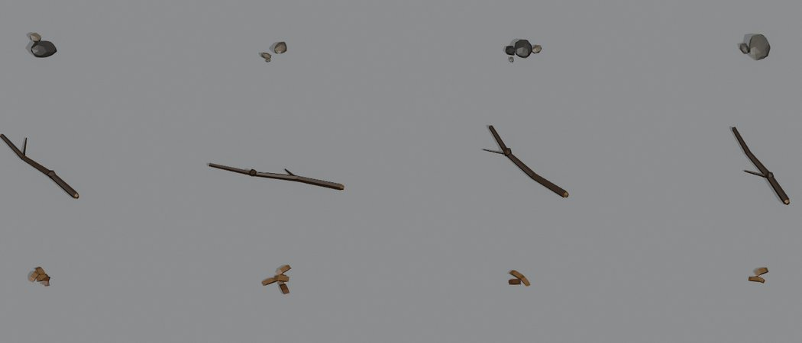
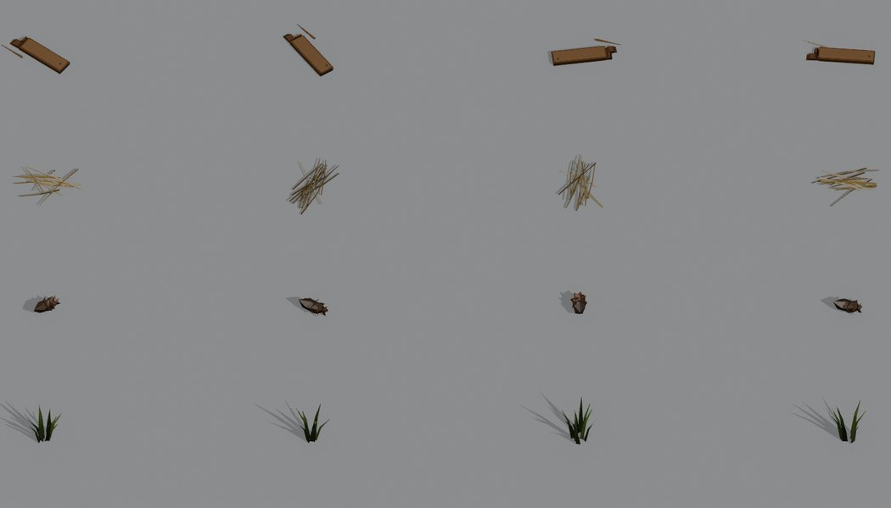
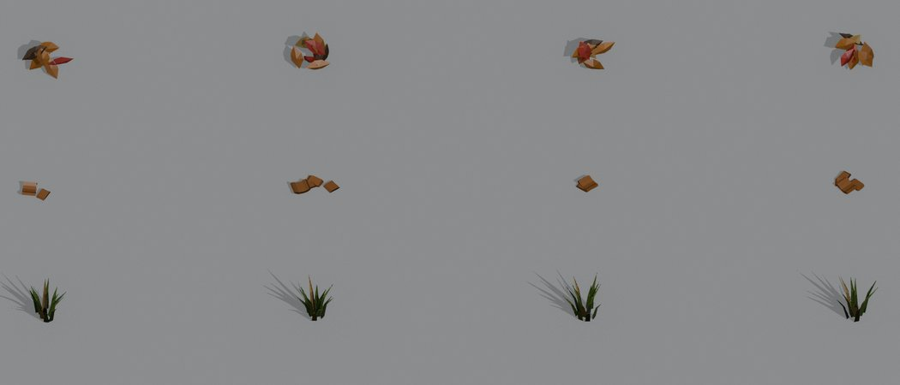

# Дрібниці на підлозі (scatter)

Шар дрібниць додає життя підлозі: камінці, палички, купки листя, шишки, кущики трави, тріски, уламки дощок, солому, черепки й сніг. Він лежить і на вільних гексах, а не лише біля стін і перешкод. Це чиста декорація: правила гри про ці речі не знають, тож на рух вони не впливають.

- Код: `src/render/environment/scatter.ts`.
- Налаштування: `src/render/floorDetail.ts`.
- Моделі: `art/blender/scatter-kit/scatter_kit.py` → `assets/models/scatter-kit`.

## Що де лежить

- **Купки** (як раніше). Види беруться з профілю локації (`SCATTER`) і лежать купками за шумом, тож одні місця багатші, а інші голі.
- **Дрібниці на вільних гексах** (нове). На частину вільних гексів лягає 1–2 речі:
  - у приміщенні: тріски, уламок дошки, солома, черепки, камінці;
  - під землею: камінці;
  - надворі: за сезоном.
- **Де саме на гексі.** Речі лежать у смузі між серединою та контуром, для обох шарів: `hexRim` від 0.5 до 0.8, а контур проходить на 0.866. Уся форма разом із розмахом (`reach`) не заходить на контур. У центрі гекса стоять фігура, жетони й монети, туди нічого не лягає.
- **Де не лежить нічого:**
  - на гексах із перешкодою, дверима, об'єктом чи пасткою;
  - у воді й на небезпечних гексах;
  - ближче ніж на долоню до стін, перегородок і реквізиту.
- **Сезон.** Нове необов'язкове поле `season` у даних локації (`spring | summer | autumn | winter`); поле додано в JSON-схему. Без нього вигляд змішаний, як був.
  - Зараз `thorn-path` (s2) має осінь, а `mountain-pass` (s7) — зиму.
  - Осінь: більше купок листя, менше трави. Літо й весна: зелена трава, листя майже немає. Зима: сніг замість листя й менше трави.
  - На осінній підлозі s2 текстура вже намальована листям. Тому серед дрібниць на гексах переважають сірі камінці, зелена трава, шишки й палички, а купок листя менше: інакше їх не видно.

## Налаштування «Дрібниці на підлозі»

Налаштування → «Дрібниці на підлозі»: **Вимк. / Трохи / Багато** (uk/de/en).

- **Типово** рівень іде за якістю графіки: low → «Трохи», medium і high → «Багато». Гравець може вибрати свій рівень.
- **Перемикання** діє одразу, без перезавантаження сценарію: `BoardEnvironment` перебудовує лише цей шар.

| Рівень | Купки | Вільні гекси з дрібницями | Речей на гекс |
|---|---|---|---|
| Вимк. | 0 | 0 | 0 |
| Трохи | 30 % | 30 % | 1 |
| Багато | 100 % | 60 % | 1–2 |

## Моделі (Blender, через MCP)

Набір `scatter-kit` має 10 видів × 4 варіанти, 3.5 тис. трикутників на весь набір:

- камінці;
- паличка з вигином, сучком і світлим зламаним кінцем;
- купка листя;
- тріски;
- уламок дошки зі зламаним кінцем, цвяхом і тріскою;
- солома;
- шишка;
- сніг;
- трава;
- черепки.

Як влаштовано:

- **Вузли.** Кожен варіант — вузол `<вид>_<n>`; дефіс чи підкреслення, бо GLTFLoader прибирає крапки з імен.
- **Матеріали** названо за ключами палітри. Гра фарбує колір палітри локації у вершини (низ трохи темніший), а кожен екземпляр трохи світліший чи темніший, щоб повтори не впадали в око.
- **Якість.** Кожен вид доведено за 5 кругами рендерів у Blender. Звіт із трикутниками, розмахом і висотою: `art/blender/scatter-kit/scatter-kit.report.json`.
- **Тест** перевіряє, що кожен вид має 4 варіанти, вкладається у свій розмах, лежить на підлозі (не висить) і має не більше 160 трикутників на варіант.

Рендери набору:

## Продуктивність

- **Малювання.** Один `THREE.BatchedMesh` на вигляд, з одним матеріалом на вигляд:
  - освітлений (усі види й варіанти разом);
  - трава, що гойдається;
  - за потреби — неосвітлений.
- **Draw calls.** Шар коштує 1–2 draw calls незалежно від кількості видів, плюс покопійне відсікання (`perObjectFrustumCulled`).
- **Тіні.** Шар не відкидає тіней на жодній якості, лише приймає їх. Сесії тіней я це запропонував; заперечень не надійшло.
- **Туман і серпанок.** `field.ts` враховує `batchingMatrix`, гойдання трави — теж (`life.ts`, сесія болота).

### Як міряли

- Headless Chrome, 1024×768, ANGLE/D3D11, дев-дошка `dev/board.html?board=sN&quality=…`.
- В одній завантаженій сторінці рівень перемикається наживо: Вимк. → Трохи → Багато, 4 круги. Кожен замір — `board.benchmark(40)` у мс на кадр, у таблиці медіана.
- Машину паралельно навантажували інші сесії, тож розкид окремих замірів великий; його наведено в останній колонці.

| Сценарій | Якість | Вимк. | Трохи | Багато | Draw calls шару (Трохи / Багато) | Екземплярів (Трохи / Багато) | Розкид окремих замірів |
|---|---|---|---|---|---|---|---|
| s1 (підвал) | low | 12.5 | 11.1 | 13.5 | 1 / 1 | 129 / 402 | 8.5–14.6 |
| s2 (тернова стежка) | low | 15.7 | 15.5 | 17.0 | 2 / 2 | 354 / 1152 | 12.7–20.4 |
| s1 (підвал) | high | 55.7 | 62.2 | 70.1 | 1 / 1 | 131 / 404 | 39.6–84.3 |
| s2 (тернова стежка) | high | 63.9 | 93.7* | 75.1 | 2 / 2 | 343 / 1126 | 54.9–129.8 |

\* Медіана для s2 high «Трохи» зіпсована одним викидом 851 мс; без нього це близько 60 мс.

**Висновок.**

- На low із «Трохи» шар коштує 1–2 draw calls і кількасот екземплярів. Різниця з «Вимк.» менша за шум (11.1 проти 12.5 мс на s1), тобто вона незначна.
- На high цифри headless-GPU надто шумні, щоб відділити вплив шару. Стабільна частина вартості — 2 draw calls і до ~1.2 тис. маленьких екземплярів.

## Перевірка очима

Знімки в `docs/art/scatter/`:

- `s1-high-many*.jpg`, `s1-low-few*.jpg` — підвал;
- `s2-high-many*.jpg`, `s2-low-few*.jpg` — тернова стежка;
- `*-zoom.jpg` — наближено (4 кроки «Ближче»);
- `before-s2-high.jpg` — s2 до змін.

Що видно на знімках:

- **Чи додає життя без захаращення.** У підвалі на краях гексів лежать жмутки соломи, черепки й тріски. На стежці — палички, камінці, трава й шишки. У більшості гексів лишається одна річ або нічого.
- **Чи читається кожен гекс.** Так: контури, підсвітка, жетони, монети й фігури не перекриті, у центрах порожньо.
- **Чи немає висіння, мерехтіння й повторів.**
  - Речі стоять на підлозі: тест перевіряє низ ≤ 3 мм, камінці трохи втоплені.
  - Пласких накладок на рівні підлоги немає, тож z-fighting не виникає.
  - Варіанти, повороти, масштаб і відтінок випадкові з фіксованим зерном, тож візерунка не видно.
- **Обмеження.** На листяній текстурі s2 дрібниці на гексах тихі: текстура сама намальована листям і гілочками. Видно передусім камінці, траву й палички.
