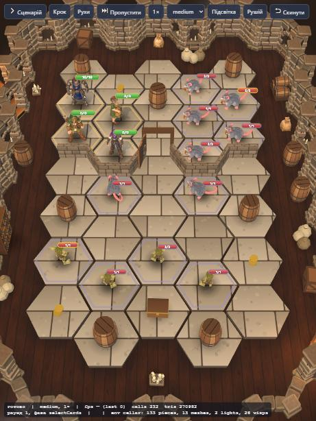
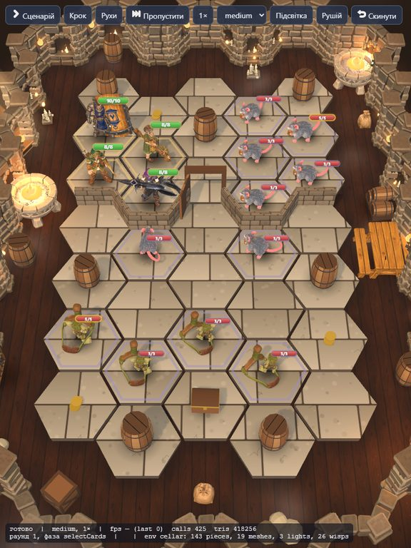
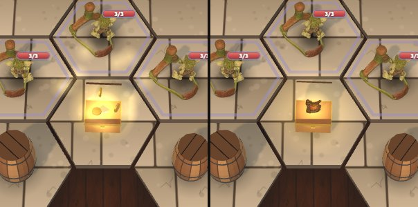

# s1 «Підвал Ситого Гусака»: показовий рівень

Мета: один рівень, доведений до вигляду «готово», як зразок для решти.
Перевірка: `/vidvazhni/dev/board.html?board=s1&quality=low|medium|high`, планшет 768×1024.

## Аудит (до роботи)

| Що | Стан | Прогалина |
|---|---|---|
| Пропси | кільце біля стін заповнене процедурними бочками, ящиками, мішками, полицями; стіни й арки з Blender-кіту | з Meshy лише `brazier` і `flour-sack`; жаровні в s1 немає зовсім; бочки-перешкоди й скриня процедурні |
| Жива анімація | мерехтіння світла й клуби Мороку є, але лише поки дошка малює кадр | дошка малює «на вимогу»: у спокої все завмирає; немає вогню, пилу в променях, низького туману |
| Світло й тіні | low: 0 точкових світел, без тіней; medium: 2 світла, тінь лише від героїв; high: 4 світла, тіні від усього | свічки в арках світять слабко, факелів на стінах немає; на medium пропси й монстри без тіні |
| Двері й перешкоди | двері [2,1] з рамою, тонкі стіни між кімнатами читаються | бочки-перешкоди не відрізняються від декору кільця |
| Скриня й лут | процедурна скриня з кришкою, при луті кришка відкидається й іскри | модель Meshy без кришки не відкриється; немає тремтіння, сяйва, польоту здобичі до героя |
| Читаність гексів | добра: плити світлі, рамки кімнат чіткі | — |

## Після роботи

| Що | Зроблено | Де |
|---|---|---|
| Жива атмосфера | язики полум'я, іскри й сяйво над кожним вогнем; пил у світлі ламп і в промені від сходів; низький туман біля стін. Усе рухається в шейдерах, один виклик малювання на вид; гасне під завісою нерозкритої кімнати | `src/render/environment/ambient.ts` |
| Дошка в спокої | малює 15 / 24 / 30 кадрів за секунду (low / medium / high), поки локація «живе»; у прихованій вкладці стоїть | `boardView.ts` (`AMBIENT_FPS`) |
| Світло | факели в кронштейнах на кожній 3-й глухій стіні (`walls.sconce`); точкових світел 0 / 3 / 5; полум'я мерехтить разом зі світлом | `cellar.json`, `pieces.ts` (`wall-torch`) |
| Тіні | medium: герої, монстри й пропси на гексах (було лише герої); high: усе; low: лише м'які контактні плями | `quality.ts` |
| Пропси | дві запалені жаровні й стіл корчми з Meshy завжди в кільці, позаду дошки, не на гексах (`dressing.anchors`); бочки, ящики, скриня й двері вже прив'язані до моделей Meshy і підхопляться, щойно моделі з'являться | `cellar.json`, `plan.ts` |
| Скриня | тремтить, спалахує золотом, вистрибують монети й іскри, кришка відкидається (якщо є), здобич летить до героя: модель (уламок ліхтаря), інакше золотий відблиск. Модель скрині без кришки після луту зменшується й зникає | `boardView.ts` (`openChest`), `boardEffects.ts` |

**Перевірка:** `dev/board.html?board=s1&quality=medium&seek=last&t=0.75` — момент відкриття скрині (крок «Скриня» на dev-сторінці).

**Продуктивність:** на low атмосфера додає 1 виклик малювання (~220 точок вогню); пилу, туману й променя на low немає. Головна ціна — перемальовування в спокої 15 разів на секунду. На iPad не міряно; якщо батарея сідатиме, знизити `AMBIENT_FPS.low` до 10.

**Далі:** моделі `crate`, `barrel`, `chest`, `dungeon-door` з Meshy (підхопляться самі); кришка скрині окремим вузлом у Blender (тоді вона відкриватиметься й на моделі); стіл із Meshy яскравіший за процедурне дерево, можливо, притемнити текстуру.
