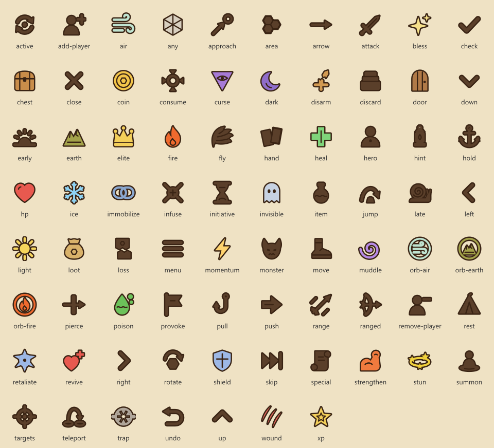

# Іконки «Відважних»

Правило від користувача: «Всі іконки, всі позначення мають бути наші. Ніде не використовуємо стандартні емодзі.»
Тому в грі немає емодзі, дінгбатів і символів-картинок (★ ✓ ⚔ 🛡 ❤ ⚡ ▲ ● →…). Усе, що позначає дію, стан чи
стихію, — власні SVG-іконки з `src/ui/icons/`. Типографіка лишається: − × … ≤ « » — · ±.



## Стиль

Еталон — `art/ui-mockups/icon-sheet/CHOICE.md` (основа v5, винятки з v1, v4, v6). Кожна іконка — окремий файл
`src/ui/icons/svg/<name>.svg`, viewBox 24×24; файли малює скрипт `tools/icon-svgs.mjs` (`node tools/icon-svgs.mjs`),
тож правити треба його, а не SVG.

1. **Ореол:** ті самі фігури, обведені на 1,5 одиниці з кожного боку кольором `var(--icon-halo, #fbf5e6)`.
   Завдяки йому іконка читається і на пергаменті, і на темному HUD. Деталі всередині силуету — того ж кольору.
2. **Силует:** заливка `currentColor`, а `.vi` задає `color: var(--icon-ink, #1f2a44)` (темно-синій).
3. **Акцент:** один на іконку, `var(--icon-accent, …)`: червоний — шкода, зелений — лікування й посилення,
   бірюзовий — стихії й магія, золотий — нагороди й решта. Той самий колір у `ICON_TINTS`.

Варіант `on-dark` — клас `vi-on-dark` на іконці або `icons-on-dark` на контейнері: світлий силует, темний ореол.
Щоб іконка брала колір тексту, на батьку задати `--icon-ink: currentColor` (так зроблено в кнопках і картах HUD).
`.vi-mono` прибирає акцент і ореол — голий силует для перевірки форм.

Тест `tests/ui/icons.test.ts` стежить за контрактом: viewBox 24, `currentColor`, ореол, не більше одного акценту
з палітри, жодних інших кольорів, без `<text>`, `<image>`, `<use>`.

## API

```ts
import { icon, iconHtml, rich, plain } from '../ui/icons';

icon('attack');                         // <svg> з aria-label з i18n («Атака ближня»)
icon('fire', { size: 32 });             // розмір у px або будь-яка CSS-довжина; типово 1.25em
icon('move', { title: false });         // декоративна (поруч є текст): aria-hidden
iconHtml('coin');                       // те саме рядком для шаблонів
rich('Атака 3 {icon:arrow} 5');         // текст + <svg> для i18n-рядків з плейсхолдерами
plain('Атака 3 {icon:arrow} 5');        // «Атака 3 – 5» для title, aria-label, копій журналу
```

- Імена — тип `IconName` (union у `src/ui/icons/names.ts`, згруповані в `ICON_GROUPS`).
- Підписи для екранних читачів — ключі `icon.<name>` у `data/i18n/{uk,de,en}.json`.
- `src/ui/icons/svg.ts` не залежить від DOM та i18n, тому його бере й рендер дошки (`src/render`).
- Ігровий екран користується обгорткою `icon(name, cls, label)` з `src/ui/game/icons.ts` (span `.gi`, який
  розмір задає game.css), а всередині — той самий набір.
- У текстах i18n іконка пишеться як `{icon:name}`; `t()` такі плейсхолдери не чіпає, а показ іде через `rich()`.

## Галерея

Dev-сервер, `?icons` (наприклад, `http://localhost:5173/vidvazhni/?icons`): усі іконки в 24/32/48 px на темній і
світлій панелі, монохромна сітка силуетів і приклади в тексті; є перемикач мови для підписів.
Код — `src/ui/icons/gallery.ts`. Скріншоти: `docs/screenshots/icons/`.

## Набір (88) і де він стоїть

Нові (аркуш іконок): `dice` кубик ініціативи, `reroll` перекидання, `gold` стоси монет, `objective-flag` прапорець цілі,
`escort` супровід, `defend-point` вежа-точка, `lever` важіль.

| Група | Іконки | Де показуються |
|---|---|---|
| Дії | `attack` меч, `ranged` лук зі стрілою, `range` стріла в польоті, `targets` приціл, `move` сліди, `jump` дуга над каменем, `fly` крило, `heal` хрест, `shield` щит, `retaliate` щит у шипах, `push` долоня, стрілки й камінь, `pull` гак, `pierce` стріла крізь пластину, `area` три гекси, `loot` мішок, `provoke` бойовий ріг, `infuse` сфера з променями, `consume` сфера, що вбирає іскри, `summon` фігурка на диску, `teleport` два портали, `special` сувій | кроки на картах (`card.ts`, `text.ts → stepIconName`), поточний крок і базові дії (`scenarioScreen.ts`), статуси героїв (`panels.ts`), очікувана шкода над ціллю на дошці (`boardView.ts`, `attack`), дебаг: кнопки цілей (`attack`) |
| Позначки карт | `initiative` секундомір, `loss` розірвана карта, `xp` зірка, `momentum` блискавка, `active` дві стрілки по колу, `bless` іскри, `curse` око в трикутнику | ініціатива й «провідна» карта, втрата/активна карта, досвід, наснага (`card.ts`, `panels.ts`, `scenarioScreen.ts`, `end.ts`), дебаг-карти (`momentum`); `initiative` також замість «?» у черзі ходів, поки карту не обрано |
| Стани | `poison` крапля з бульками, `wound` пластир із блискавкою, `immobilize` дві ланки ланцюга, `disarm` меч, що випадає з руки, `stun` зірки на орбіті, `muddle` спіраль, `invisible` привид, `strengthen` зігнута рука | рядок станів героїв і монстрів (`panels.ts → statusRow`), значки над фігурами на дошці (`boardOverlay.ts`), кроки «наклади стан» |
| Стихії | `fire` полум'я, `ice` сніжинка, `air` вітер, `earth` дві вершини, `light` сонце, `dark` півмісяць, `any` шестипроменева зірка; сфери форку `orb-fire`, `orb-earth`, `orb-air` (та сама стихія в кільці) | панель стихій (`panels.ts`), бонуси поглинання на картах (`card.ts`), вибір стихії (`scenarioScreen.ts`) |
| Світ | `door`, `trap` щелепи пастки, `chest`, `coin`, `hp` серце, `monster` рогата голова, `hero` погруддя, `elite` корона | здоров'я й монети (`panels.ts`, `end.ts`), монети, що злітають на дошці (`boardView.ts`, `coin`), щит над фігурою (`boardOverlay.ts`, `shield`), черга ходів (`monster`) |
| Інтерфейс | `hand`, `discard`, `rest` намет, `item` флакон, наміри `approach`, `hold` якір, `early` схід сонця, `late` равлик, `undo`, `skip`, `menu`, `close`, `left`, `right`, `up`, `down`, `check`, `rotate`, `hint` ліхтар, `revive` серце з плюсом, `arrow` стрілка в тексті, `add-player`, `remove-player` | кнопки й шторки (`scenarioScreen.ts`, `app.ts`, `newGame.ts` — «більше/менше гравців»), наміри (`panels.ts`), стрілка в текстах «Атака 3 → 5», «хто → кого» в журналі (`{icon:arrow}`), дебаг: напрямки області (`arrow`, повернута), верх/низ карти (`up`/`down`), згортання панелей, позначка героя, що має обрати (`hint`), dev-сторінки дошки й моделей |

## Що змінилося в текстах

- `{icon:arrow}` замість «→» у `game.bonus`, `game.itemPrompt`, `game.modifier.line`, `game.ev.attacked`,
  `debug.itemPrompt`, `debug.ev.attacked`, `debug.ev.cardMoved`; `{icon:hint}` замість «•» у `debug.pickHeroTab`.
- `debug.eliteMark` «★» → «Е/E», `debug.marker.obstacle` «▲» → «Перешкода», `debug.marker.coins` «¢{n}» → «Монети {n}»
  (ці підписи малюються на canvas-жетонах, де SVG не вставити).
- Жетони заглушки дошки (`?stub`) і дебаг-дошки: «⚔3» → «(3)», «→ 4» → «Рух 4», «✔ Х» → «[Х]».

## Щоб не повернулося

`tests/ui/icons-no-emoji.test.ts` падає, якщо в `src/` (код без коментарів, CSS, SVG, HTML) або в
`data/i18n/*.json` трапиться емодзі (Extended_Pictographic), дінгбат, символ із блоків Arrows, Misc Technical,
Geometric Shapes, Misc Symbols, Misc Symbols and Arrows, кружечок-маркер «•» чи «¢». Емодзі заборонені й у коментарях.
